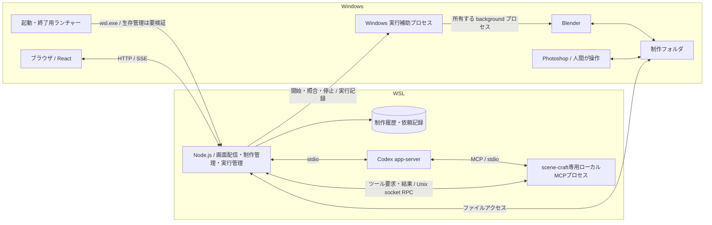

# アプリ全体と Windows・WSL の責務

[設計 Issue](https://github.com/Kurarowa305/scene-craft/issues/3)。2026-10-12、利用者と OS 配置・手動起動に加え、React＋TypeScript、Node.js＋Fastify、WSL 側 SQLite、HTTP／SSE、安全に停止してからの終了、scene-craft 専用の Codex 保存領域を合意した。同日、依存先の Blender 連携設計が完了し、保存済み入力のコピーを Windows 補助プロセス経由で background Blender に処理させる契約を引き継いだ。同日、起動管理・連絡喪失時の停止・保存設定・モジュール構成も最終合意し、本領域の設計を完了した。本実装・実機検証の完了とは区別する。

## 合意済みの配置と利用方法

2026-10-31、[エージェント契約の設計](agent-contracts.md)でscene-craft専用stdio MCPを採用し、以下の配置・構成図・責務へローカルMCPプロセスを追加した。既製MCP for Blenderの採用ではない。制作操作のbackground方式と、制作管理・実行管理による検査は維持する。

| 場所 | 担当 |
| --- | --- |
| Windows | ブラウザ、Blender、Photoshop |
| WSL | 会話・制作履歴の管理、依頼の実行管理、Codex app-server、scene-craft専用ローカルMCPプロセス |
| Windows 側の制作フォルダ | `.blend`、`.psd`、テクスチャ、レンダー画像 |

Windows のショートカットから使うときに起動する。ブラウザを閉じてもローカルの処理を継続し、明示的な「アプリ終了」で停止する。PC 再起動後はアプリを開き、人間が制作の再開を指示する。ログイン時の自動起動を初期の運用にしない。

WSL 上で成立した app-server の接続を活かし、Windows の制作アプリから扱うファイルを Windows 側に置く。OS をまたぐファイルアクセス・プロセス管理が必要になる負担を引き受ける。具体的なドライブと保存ルートは利用開始時に設定し、接続経路は以下の契約に従う。

OS と保存領域を分ける判断の理由・負担は [ADR 0005](../adr/0005-wsl-runtime-and-windows-production-files.md) に記録する。

## 合意した構成

配置、React／TypeScript・Node.js／Fastify・SQLite・HTTP／SSE の採用、終了時に安全な停止を待つこと、Codex 保存領域の分離は合意済み。以下のモジュール分割・パス表現・ランチャーの方式も合意済み。

### 技術とプロセス

- 画面は React・TypeScript を採用する。ビルドは Vite を採用する。ローカル用途のため初期は静的にビルドした画面を配信する。
- WSL のバックエンドは Node.js・Fastify を採用し、TypeScript で記述する。一つの常駐プロセスに画面配信・制作管理・実行管理を置き、app-server、専用ローカルMCP、Blender は別プロセスとして扱う。10の役割を10の常駐プロセスにはしない。
- 専用ローカルMCPはCodexがWSL側で起動し、stdioでツール要求と結果を交換する。MCPはバックエンドの制作管理・実行管理へ要求を渡すアダプターとし、DB・確定した制作ファイルを直接更新したり、独自にWindows Blenderを起動したりしない。MCPとバックエンドは認可付きUnix domain socketのローカルRPCで接続し、依頼コンテキスト参照を会話・依頼・実行・世代へ照合する。契約は[エージェント設計](agent-contracts.md)に従い、プロセス共有数と具体的な通信スキーマは実装仕様で確定する。
- 依頼の寿命を HTTP リクエストや画面の接続に結び付けない。バックエンドが依頼を記録して受け付け、進捗と終端を保存する。CPU を長時間使う処理は HTTP の受付を止めない実行方法にする。
- 制作履歴・依頼記録は WSL の Linux ファイルシステム上の SQLite を採用する。データ構造は「作品と制作履歴のデータモデルを決める」、バックアップは「制作データの保存・復元・バックアップ方式を決める」で具体化する。
- 一つのバックエンドが終了すると画面配信も使えなくなる。一方、Codex の認証切れ・利用上限・app-server の障害だけなら、履歴閲覧・手作業の記録・バックアップは継続できるよう責務を分ける。
- パッケージの版・DB ドライバーは実装仕様で互換性を確認して固定する。現在導入済みの Node は 24.21.0、pnpm は 12.11.2。これだけで製品の依存関係を検証済みとはしない。

React と TypeScript で会話・作品・編集案の状態を画面へ表現し、Node.js と共通の言語で保守する。Fastify に HTTP 受付と静的配信をまとめ、SQLite に一人用のローカル記録を置くことで、別の DB サーバーの運用を避ける。HTTP と SSE は指示と進捗を分け、ブラウザの再接続を依頼の再実行から独立させるために選ぶ。

### 通信とモジュールの責務

ブラウザからの指示は HTTP、進捗配信は SSE を採用する。画面・指示・進捗を同じ origin から提供し、localhost のみで受け付ける。再接続時は保存済み状態を読み、イベントの重複・欠落を照合する。SSE の再接続を制作の再実行指示として扱わない。

| モジュール | 引き受ける責務 |
| --- | --- |
| 画面と HTTP 受付 | 入力の検証、指示の受付、表示。Codex や Blender を直接操作しない |
| 制作管理 | 作品・保存状態・編集案・採否・保護指定の判断。通信方式や OS パスを持ち込まない |
| 実行管理 | 依頼 ID、順序、停止、実行済み操作の照合、再実行予算。ブラウザの生存から独立する |
| Codex 接続 | 子プロセスと stdio、thread/turn の対応、イベント解釈。制作の採否を決定しない |
| 専用MCPアダプター | Codexへ制作ツールを公開し、認可付きの要求と結果をバックエンドへ中継する。依頼の正本・保護・順序・再実行予算は制作管理・実行管理へ照合する |
| Blender 操作 | 操作要求・結果・停止の扱い。実行側でも変更範囲と保護指定を確認する |
| 保存 | 記録・制作ファイルの参照、OS パス変換、復元に必要な実体の扱い |

制作管理・実行管理が必要とするインターフェースを定義し、Codex・Blender・保存のアダプターを接続する。ブラウザから渡された任意パスやモデルの任意コマンドを、そのまま実行する契約にはしない。localhost であっても Host・Origin と変更要求の正当性を確認し、別サイトからの操作を受け付けない。具体的なローカルセッション方式は実装仕様で定義する。

### 保存領域とパス

Windows の制作ルートと WSL の管理データを分ける。制作ファイルは保存ルート ID と相対パスで参照し、実際の Windows パスと WSL パスへの変換を保存モジュールに集める。ブラウザには作品・生成物の ID を渡し、ローカルファイルの表示・取得はバックエンドを通す。

記録 DB と Windows のファイル更新は一つのトランザクションにならないため、書き込み途中・コピー失敗・保存先の不在を検知して照合できる記録が必要になる。コピー完了前に保存状態を完成扱いにしない。整合性・復元・バックアップの契約は保存設計へ引き継ぐ。ルートからの逸脱やリンク先も確認する。

Codex 用には WSL に scene-craft 専用の保存領域を用意し、普段の開発用 Codex の設定・会話・認証ファイルと分ける。初回はその領域で同じ ChatGPT アカウントへログインする。認証の保存・更新は Codex に任せ、既存トークンをアプリがコピーしない。Codex 標準のファイル保管を採用し、所有ユーザーにアクセスを限定する。資格情報はブラウザ、制作バックアップ、Git、診断出力に含めない。Codex の会話継続用データをどこまで移行対象にするかは、制作記録との区別を保って保存設計で決める。

専用領域は設定の混在を減らすものであり、同一 OS ユーザーからのアクセスを隔離する仕組みではない。Codex のプロジェクト設定など別の設定層もあるため、許可するツールと実行設定を接続時に確認する。

### 起動・終了・再接続

1. ショートカットは既存の scene-craft を識別する。起動済みなら画面を開き、同じ保存領域に別の書き込みプロセスを起動しない。ポートが別アプリに使われている場合は起動失敗を示す。
2. 未起動なら指定の WSL ディストリビューションでバックエンドを起動し、準備完了を待ってブラウザを開く。Codex が利用不能でも、記録の読み書きが可能なら画面を利用できるようにする。
3. ブラウザや起動用ターミナルを閉じても処理を維持する。そのために以下の Windows 起動管理プロセスを採用し、ブラウザ・端末終了後の継続を実装時に実機確認する。systemd の登録だけで WSL の生存が保証されるとはしない。
4. 「アプリ終了」は新規依頼と待機依頼の着手を止め、停止要求を保存し、実行中の操作を安全に止められるところまで待つ。制作結果を記録して、所有するプロセスを終了する。人間が起動した Blender や Photoshop は閉じない。
5. 停止不能・応答不明なら終了待ちと対象を示す。停止確認前に「終了済み」としない。強制終了を設ける場合は利用者の明示操作とし、未保存の可能性と次回の状態照合を伴わせる。Windows 側は補助プロセスが所有する対象を照合し、Blender 連携設計の編集・保存とレンダーの停止契約を適用する。
6. バックエンド再起動時は未完了の依頼を照合し、人間の再開指示を待つ。前回の Windows 側操作が生き残っているか不明な場合、新しい競合操作を開始しない。ブラウザを開き直しただけの場合は、実行中の進捗へ再接続する。

専用MCPの起動失敗・切断時は、その接続で新しい制作操作を始めない。MCPの終了だけで外部Blender処理の停止・未実行を確定せず、バックエンドがWindows側の実行記録を照合する。アプリ終了時も制作操作の停止・記録を先に確認してから、Codexと専用MCPを含む所有プロセスを終了する。MCPの再起動だけで制作操作を自動再送しない。LLM不要の閲覧・手作業記録は専用MCPに依存させない。

### 生存管理

Windows のショートカットは、端末ウィンドウを出さない起動管理プロセスを開始する。そのプロセスが `wsl.exe` を起動して終了まで保持し、WSL 内ではバックエンドを foreground で動かす。バックエンドを daemon 化して起動元を終了する方式にはしない。管理プロセスはブラウザから独立し、準備完了後に画面を開く。systemd のサービス登録やログイン時の自動起動は初期の必須構成にしない。Windows ログアウトや WSL 強制終了まで継続を保証するものではない。

管理プロセスの責務は起動・既存インスタンスの確認・終了監視・起動失敗の通知に限定する。制作の順序や再実行は WSL 側が判断する。二重起動は起動元とバックエンドで防ぎ、単に同じポートが開いているだけで自分のアプリと判定しない。バックエンドが落ちたら自動で制作を再開せず、ショートカットから開き直す。画面を開けない場合も、起動失敗とログの場所を確認できる入口を用意する。

Windows 補助プロセスは実行ごとに所有権を持ち、Blender のプロセスハンドルと実行 ID・PID・起動時刻・実行ファイル・実行用ディレクトリを対応付ける。実行開始の受付記録を先に残し、同じ実行 ID で二重に開始しない。開始直後に落ちて所有権を確定できなかった実行は状態不明とし、自動再送しない。プロセス名一括指定の終了は行わない。

補助プロセスは Windows 側で起動元のシェルから独立して実行し、ログ・要求・処理に必要な入力を Windows 側へ置く。WSL の標準入出力や WSL 内のファイルがなくても、現在の操作を安全な境目まで進めて記録できる構成とする。Windows 停止や補助プロセス自体の強制終了では、この記録を保証できない。

WSL と補助プロセスの交換には実行ごとの Windows 側ディレクトリを使う。開始要求、停止要求、進捗、チェックポイント、完成記録を分け、書き込み途中のファイルを完成記録として読ませない。起動引数は固定の補助プログラムと要求ファイルの参照だけとし、任意のシェル文字列を組み立てない。要求の世代と実行 ID を検査して、前回の要求や遅れた通知を新しい実行へ適用しない。通知がなくても永続記録を再読できるようにする。

| 失われたもの | 合意した扱い |
| --- | --- |
| ブラウザの接続 | 実行を継続。再接続時に現在状態を取得する |
| WSL／バックエンドとの連絡 | Windows 補助プロセスが連絡の期限切れを検出し、新しい操作・工程への進行を止める。編集中・保存中は安全な境目でチェックポイントを残して止める。レンダーは保存済み入力を持つ専用プロセスを終了し、未完成画像を完成扱いにしない |
| Windows 補助プロセス | バックエンドが状態不明として記録。残った Blender の所有権と保存状態を照合し、競合する新しい操作を止める。保存途中のプロセスを自動で強制終了しない |
| PC・Windows セッション | 次回起動時に記録と実体を照合し、人間の再開指示を待つ |

連絡の期限切れは OS 上の死亡確認ではない。連絡が戻っただけで停止を撤回せず、停止状態と記録を照合する。期限、更新方法、停止要求との競合、二重起動の排他方式は実行状態設計で具体化する。停止可能な境目へ到達しない編集は停止待ちとして扱い、人間が明示した強制終了以外では保存途中を切らない。補助プロセス終了時に子を無条件で強制終了する仕組みも、この保存契約を満たすとは扱わない。

### 保存と実装構成

- React の静的ビルドに Vite、バックエンドの記述に TypeScript を使う。制作判断、実行管理、外部接続を前述のモジュールにまとめ、通信や OS パスを制作判断へ持ち込まない。
- 管理 DB と Codex 用保存領域は WSL の Linux ファイルシステム上の別ディレクトリとする。Codex は標準の file 保管を使い、ディレクトリを所有者のみアクセス可能にする。認証ファイルの作成・更新は Codex が行う。scene-craft の制作データ書き出しは含める項目を選ぶ方式とし、親ディレクトリの丸ごとコピーで資格情報を混入させない。
- Windows の制作ルートは設定で登録し、初期の対象はこの PC のローカルディスクとする。ルート ID と相対パスで参照し、移行時はルートの対応を差し替える。パス変換、リンク先・ルート逸脱の検査は保存モジュールが担う。具体的なドライブ名は利用開始時に設定し、コードへ固定しない。
- 記録 DB、Codex の内部状態、Windows の実行記録と生成物を別の役割として扱う。外部処理の成功を画面表示や終了コードだけから推定せず、検証済みファイルと完成記録を照合して作品へ反映する。

## 根拠・確認範囲

- [初期要件](../requirements/initial-scope.md) と [LLM 接続設計](llm-connection.md) の停止・手動再開・費用条件を維持する。
- [app-server 実接続確認](../research/codex-app-server-connection-validation.md): WSL で接続済み。SQLite とログを WSL 側に分けると起動成功したが、失敗原因は未特定で、認証・会話全体を分離した検証ではない。
- 2026-10-12 の読み取り専用調査: PID 1 は systemd、ユーザーマネージャーは running、Linger は no。サービス側 PATH に Node の導入ディレクトリがない。起動には実行ファイルの絶対パス等を明示する必要がある。
- [Microsoft の WSL networking](https://learn.microsoft.com/en-us/windows/wsl/networking): Windows から WSL 内の Web アプリへの localhost 接続を説明。現在の PC での scene-craft 接続は未検証。
- [Microsoft の systemd 対応説明](https://devblogs.microsoft.com/commandline/systemd-support-is-now-available-in-wsl/): systemd サービスだけでは WSL インスタンスを維持しないと明記。現行環境でブラウザ・ターミナルを閉じた後の生存確認が必要。
- [Windows の Start-Process](https://learn.microsoft.com/en-us/powershell/module/microsoft.powershell.management/start-process): Windows では起動元シェルから独立したプロセスを開始できる。起動管理・補助プロセスの方式の根拠であり、WSL 切断時の保存や生存を検証した結果ではない。
- [Windows のプロセス識別子とハンドル](https://learn.microsoft.com/en-us/windows/win32/procthread/process-handles-and-identifiers): PID の有効期間とハンドルを区別する根拠。ハンドルを保持するだけでプロセスが稼働し続けるとは扱わない。再接続時の所有権照合はアプリ側の契約として実装・検証する。
- [Fastify](https://fastify.dev/docs/latest/)、[Vite](https://vite.dev/guide/)、[Node 子プロセス](https://nodejs.org/api/child_process.html)、[SSE](https://developer.mozilla.org/en-US/docs/Web/API/Server-sent_events/Using_server-sent_events): 技術構成の根拠にした公式文書。技術の採用と製品での動作確認は区別する。
- [Codex の保存領域](https://learn.chatgpt.com/docs/config-file/config-advanced)、[認証の保管](https://learn.chatgpt.com/docs/auth): 専用 CODEX_HOME と file 保管の根拠。導入済み版での専用領域・起動方式の組み合わせは未検証。

## 後続への引き継ぎと完了の範囲

[app-serverの機能別分担調査](../research/codex-app-server-ui-capabilities.md)に、標準の会話基盤とscene-craftのUI・DB・制作実行・Windows通常プログラムの境界を整理した。実験project APIやファイル／添付RPCの存在は、作品モデル・制作実体の管理・バックアップを代替しない。配置と通信の合意は変更しない。

本 Issue の構成図、OS・プロセスの責務、通信、起動・終了・再接続の設計は合意済み。以下は未合意の構成判断ではなく、後続領域で具体化する契約と実装時の検証である。
- [Blender の操作経路とレンダー出力契約を決める](https://github.com/Kurarowa305/scene-craft/issues/4): 設計完了。[確定した操作・出力・停止契約](blender-integration.md) を引き継ぐ。保存中の協調停止、補助プロセス障害後の照合など未検証の異常系を検証済みとは扱わない。
- [作品と制作履歴のデータモデルを決める](https://github.com/Kurarowa305/scene-craft/issues/5)、[制作データの保存・復元・バックアップ方式を決める](https://github.com/Kurarowa305/scene-craft/issues/6): 記録の構造と二つの OS にまたがる実体の整合性、パス・バックアップ・移行。
- [実行状態・順序制御・再実行・復旧を決める](https://github.com/Kurarowa305/scene-craft/issues/7)、[工程別エージェントの入出力とツール契約を決める](https://github.com/Kurarowa305/scene-craft/issues/9): 依頼・停止・再実行・操作権限の具体的な契約。
- [テスト境界・診断情報・初期版の受け入れ手順を決める](https://github.com/Kurarowa305/scene-craft/issues/14): Windows からの起動・再接続、二重起動、ブラウザとターミナル終了後の継続、終了途中の失敗、再起動時の生存プロセス照合を確認する。

Windows 起動管理・補助プロセスの実装言語、パッケージ固定版、ポート、ローカルセッション方式、要求ファイルのスキーマは実装仕様で定める。連絡期限・更新間隔・排他と状態遷移は実行状態設計へ、バックアップの集合と整合性は保存設計へ渡す。実機で契約が成立しなければ本設計を見直し、未検証のまま製品の受け入れ完了にはしない。
