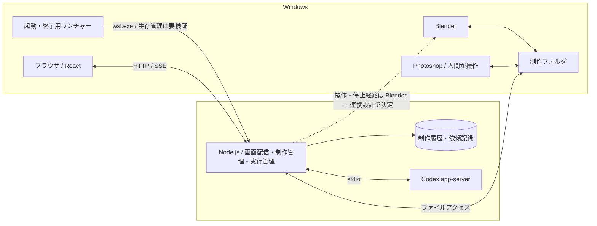

# アプリ全体と Windows・WSL の責務

[設計 Issue](https://github.com/Kurarowa305/scene-craft/issues/3)。2026-10-12、利用者と OS 配置・手動起動に加え、React＋TypeScript、Node.js＋Fastify、WSL 側 SQLite、HTTP／SSE、安全に停止してからの終了、scene-craft 専用の Codex 保存領域を合意した。ランチャーの生存管理方式と Blender の操作・停止経路は未確定で、設計全体の完了・実装・実機検証は未完了。

## 合意済みの配置と利用方法

| 場所 | 担当 |
| --- | --- |
| Windows | ブラウザ、Blender、Photoshop |
| WSL | 会話・制作履歴の管理、依頼の実行管理、Codex app-server |
| Windows 側の制作フォルダ | `.blend`、`.psd`、テクスチャ、レンダー画像 |

Windows のショートカットから使うときに起動する。ブラウザを閉じてもローカルの処理を継続し、明示的な「アプリ終了」で停止する。PC 再起動後はアプリを開き、人間が制作の再開を指示する。ログイン時の自動起動を初期の運用にしない。

WSL 上で成立した app-server の接続を活かし、Windows の制作アプリから扱うファイルを Windows 側に置く。OS をまたぐファイルアクセス・プロセス管理が必要になる負担を引き受ける。具体的なドライブ、保存ルート、接続経路はこの配置だけでは確定しない。

OS と保存領域を分ける判断の理由・負担は [ADR 0005](../adr/0005-wsl-runtime-and-windows-production-files.md) に記録する。

## 合意した構成と具体化案

配置、React／TypeScript・Node.js／Fastify・SQLite・HTTP／SSE の採用、終了時に安全な停止を待つこと、Codex 保存領域の分離は合意済み。以下のモジュール分割・パス表現・ランチャーの詳細は具体化案であり、設計全体の最終確認時に合わせて確認する。

### 技術とプロセス

- 画面は React・TypeScript を採用する。ビルドは Vite を具体化案とする。ローカル用途のため初期は静的にビルドした画面を配信する。
- WSL のバックエンドは Node.js・Fastify を採用し、TypeScript で記述する案とする。一つの常駐プロセスに画面配信・制作管理・実行管理を置き、app-server と Blender は別プロセスとして扱う。9つの工程を9つの常駐プロセスにはしない。
- 依頼の寿命を HTTP リクエストや画面の接続に結び付けない。バックエンドが依頼を記録して受け付け、進捗と終端を保存する。CPU を長時間使う処理は HTTP の受付を止めない実行方法にする。
- 制作履歴・依頼記録は WSL の Linux ファイルシステム上の SQLite を採用する。データ構造は「作品と制作履歴のデータモデルを決める」、バックアップは「制作データの保存・復元・バックアップ方式を決める」で具体化する。
- 一つのバックエンドが終了すると画面配信も使えなくなる。一方、Codex の認証切れ・利用上限・app-server の障害だけなら、履歴閲覧・手作業の記録・バックアップは継続できるよう責務を分ける。
- パッケージの版・DB ドライバーは実装仕様で互換性を確認して固定する。現在導入済みの Node は 24.21.0、pnpm は 12.11.2。これだけで製品の依存関係を検証済みとはしない。

### 通信とモジュールの責務

ブラウザからの指示は HTTP、進捗配信は SSE を採用する。画面・指示・進捗を同じ origin から提供し、localhost のみで受け付ける。再接続時は保存済み状態を読み、イベントの重複・欠落を照合する。SSE の再接続を制作の再実行指示として扱わない。

| モジュール | 引き受ける責務 |
| --- | --- |
| 画面と HTTP 受付 | 入力の検証、指示の受付、表示。Codex や Blender を直接操作しない |
| 制作管理 | 作品・保存状態・編集案・採否・保護指定の判断。通信方式や OS パスを持ち込まない |
| 実行管理 | 依頼 ID、順序、停止、実行済み操作の照合、再実行予算。ブラウザの生存から独立する |
| Codex 接続 | 子プロセスと stdio、thread/turn の対応、イベント解釈。制作の採否を決定しない |
| Blender 操作 | 操作要求・結果・停止の扱い。実行側でも変更範囲と保護指定を確認する |
| 保存 | 記録・制作ファイルの参照、OS パス変換、復元に必要な実体の扱い |

制作管理・実行管理が必要とするインターフェースを定義し、Codex・Blender・保存のアダプターを接続する。ブラウザから渡された任意パスやモデルの任意コマンドを、そのまま実行する契約にはしない。localhost であっても Host・Origin と変更要求の正当性を確認し、別サイトからの操作を受け付けない。具体的なローカルセッション方式は実装仕様で定義する。

### 保存領域とパス

Windows の制作ルートと WSL の管理データを分ける。制作ファイルは保存ルート ID と相対パスで参照し、実際の Windows パスと WSL パスへの変換を保存モジュールに集める。ブラウザには作品・生成物の ID を渡し、ローカルファイルの表示・取得はバックエンドを通す。

記録 DB と Windows のファイル更新は一つのトランザクションにならないため、書き込み途中・コピー失敗・保存先の不在を検知して照合できる記録が必要になる。コピー完了前に保存状態を完成扱いにしない。整合性・復元・バックアップの契約は保存設計へ引き継ぐ。ルートからの逸脱やリンク先も確認する。

Codex 用には WSL に scene-craft 専用の保存領域を用意し、普段の開発用 Codex の設定・会話・認証ファイルと分ける。初回はその領域で同じ ChatGPT アカウントへログインする。認証の保存・更新は Codex に任せ、既存トークンをアプリがコピーしない。具体化案は Codex 標準のファイル保管とし、所有ユーザーにアクセスを限定する。資格情報はブラウザ、制作バックアップ、Git、診断出力に含めない。Codex の会話継続用データをどこまで移行対象にするかは、制作記録との区別を保って保存設計で決める。

専用領域は設定の混在を減らすものであり、同一 OS ユーザーからのアクセスを隔離する仕組みではない。Codex のプロジェクト設定など別の設定層もあるため、許可するツールと実行設定を接続時に確認する。

### 起動・終了・再接続

1. ショートカットは既存の scene-craft を識別する。起動済みなら画面を開き、同じ保存領域に別の書き込みプロセスを起動しない。ポートが別アプリに使われている場合は起動失敗を示す。
2. 未起動なら指定の WSL ディストリビューションでバックエンドを起動し、準備完了を待ってブラウザを開く。Codex が利用不能でも、記録の読み書きが可能なら画面を利用できるようにする。
3. ブラウザや起動用ターミナルを閉じても処理を維持する。そのためのランチャー／管理プロセスの方式は実機確認後に確定する。systemd の登録だけで WSL の生存が保証されるとはしない。
4. 「アプリ終了」は新規依頼と待機依頼の着手を止め、停止要求を保存し、実行中の操作を安全に止められるところまで待つ。制作結果を記録して、所有するプロセスを終了する。人間が起動した Blender や Photoshop は閉じない。
5. 停止不能・応答不明なら終了待ちと対象を示す。停止確認前に「終了済み」としない。強制終了を設ける場合は利用者の明示操作とし、未保存の可能性と次回の状態照合を伴わせる。Windows 側子プロセスまで止める具体的方法は Blender 連携設計に依存する。
6. バックエンド再起動時は未完了の依頼を照合し、人間の再開指示を待つ。前回の Windows 側操作が生き残っているか不明な場合、新しい競合操作を開始しない。ブラウザを開き直しただけの場合は、実行中の進捗へ再接続する。

## 根拠・確認範囲

- [初期要件](../requirements/initial-scope.md) と [LLM 接続設計](llm-connection.md) の停止・手動再開・費用条件を維持する。
- [app-server 実接続確認](../research/codex-app-server-connection-validation.md): WSL で接続済み。SQLite とログを WSL 側に分けると起動成功したが、失敗原因は未特定で、認証・会話全体を分離した検証ではない。
- 2026-10-12 の読み取り専用調査: PID 1 は systemd、ユーザーマネージャーは running、Linger は no。サービス側 PATH に Node の導入ディレクトリがない。起動には実行ファイルの絶対パス等を明示する必要がある。
- [Microsoft の WSL networking](https://learn.microsoft.com/en-us/windows/wsl/networking): Windows から WSL 内の Web アプリへの localhost 接続を説明。現在の PC での scene-craft 接続は未検証。
- [Microsoft の systemd 対応説明](https://devblogs.microsoft.com/commandline/systemd-support-is-now-available-in-wsl/): systemd サービスだけでは WSL インスタンスを維持しないと明記。現行環境でブラウザ・ターミナルを閉じた後の生存確認が必要。
- [Fastify](https://fastify.dev/docs/latest/)、[Vite](https://vite.dev/guide/)、[Node 子プロセス](https://nodejs.org/api/child_process.html)、[SSE](https://developer.mozilla.org/en-US/docs/Web/API/Server-sent_events/Using_server-sent_events): 技術構成の根拠にした公式文書。技術の採用と製品での動作確認は区別する。
- [Codex の保存領域](https://learn.chatgpt.com/docs/config-file/config-advanced)、[認証の保管](https://learn.chatgpt.com/docs/auth): 専用 CODEX_HOME と file 保管の候補の根拠。導入済み版での専用領域・起動方式の組み合わせは未検証。

## 残る判断と後続設計

- 本 Issue: ランチャーの生存管理方式、Codex 標準ファイル保管の具体化、パス・モジュール間の契約、Blender 接続を含む構成図の最終合意。技術構成・HTTP／SSE・専用保存領域・安全に停止してからの終了の採否は解決済み。
- [Blender の操作経路とレンダー出力契約を決める](https://github.com/Kurarowa305/scene-craft/issues/4): 操作・完了・失敗・停止経路。未完了の依存先として維持し、全体設計を先に完了扱いにしない。
- [作品と制作履歴のデータモデルを決める](https://github.com/Kurarowa305/scene-craft/issues/5)、[制作データの保存・復元・バックアップ方式を決める](https://github.com/Kurarowa305/scene-craft/issues/6): 記録の構造と二つの OS にまたがる実体の整合性、パス・バックアップ・移行。
- [実行状態・順序制御・再実行・復旧を決める](https://github.com/Kurarowa305/scene-craft/issues/7)、[工程別エージェントの入出力とツール契約を決める](https://github.com/Kurarowa305/scene-craft/issues/9): 依頼・停止・再実行・操作権限の具体的な契約。
- [テスト境界・診断情報・初期版の受け入れ手順を決める](https://github.com/Kurarowa305/scene-craft/issues/14): Windows からの起動・再接続、二重起動、ブラウザとターミナル終了後の継続、終了途中の失敗、再起動時の生存プロセス照合を確認する。
