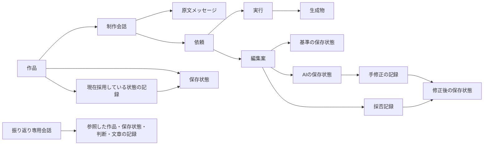
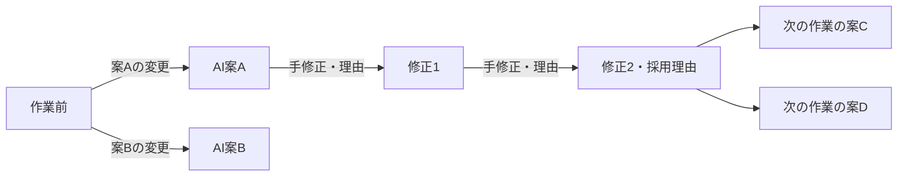

# 作品と制作履歴のデータモデル

[設計 Issue](https://github.com/Kurarowa305/scene-craft/issues/5)。2026-10-12、利用者とブランチグラフによる制作履歴、複数作品の振り返り専用会話、理由・要約の訂正履歴、代替案からの選択と独立した変更の採否、復元の記録を合意した。同日、利用者が関係図・データ契約・不変条件・具体例を含む本書全体を確定した。本領域の設計は完了し、本実装・実機検証は後続へ引き継ぐ。

## 対象と責務

作品の記録を WSL 側 SQLite、制作ファイルを Windows 側に置く[全体設計](application-architecture.md)に従う。本書は論理的な識別子、参照関係、記録が成立する単位を決める。SQL のテーブル分割・ID 生成方式・物理コピー・バックアップ方式は決めない。

制作履歴の節点は保存状態、枝は制作データの変更、採否は特定の編集案・保存状態に対する判断とする。会話・実行・理由はそれらを説明する記録であり、発言や処理のたびに保存状態を作る必要はない。制作の節点を Git コミットそのものとして管理せず、定義・作風の版だけを Git フルコミットハッシュで参照する。

## 関係図とブランチグラフ

編集案への手修正がない場合、採否記録は AI の保存状態を直接参照する。各保存状態はファイル参照の集合を持ち、AI の生成物も人間が登録した制作ファイルも含められる。後者を AI の「生成物」とは呼ばない。

図の名前は例示用であり、独自の版番号ではない。採用だけでファイル内容が変わらないときは保存状態を増やさず、採否記録と現在状態の更新を残す。人間の修正のたびに元の AI 案を上書きせず、新しい保存状態へ枝を伸ばす。

節点・枝から、変更要約、実行／手修正の由来、変更理由、採否と採用理由を ID で取得できるようにする。複数の判断がある場合も最新の理由一つに潰さず、判断した時点ごとに取得する。理由が未入力なら未入力と分かる。ホバーの見せ方、長い履歴の省略、復元線・派生線の描き分けは[画面設計](https://github.com/Kurarowa305/scene-craft/issues/12)で決める。

## 識別と共通契約

- 作品・会話・メッセージ・依頼・実行・編集案・保存状態・変更・採否・文章記録・ファイル参照は、それぞれ永続 ID を持つ。ID は対象の同一性を示し、順番や版を意味しない。表示名の変更、保存場所の移動、バックアップ復元で ID を作り直さない。取り込み時の重複・衝突の扱いは保存設計で具体化する。
- 記録時刻を必須とし、後日登録で実際の作業時刻が分かる場合は別に記録する。不明な過去の作業時刻や理由を捏造しない。同時刻でも参照関係と確定順を識別できるようにし、日時のソートだけで親子関係を作らない。
- 作品に属する記録は作品 ID を持つ。複数作品の振り返りは対象作品集合を持ち、通常の制作依頼の変更先は一作品に限る。他作品の保存状態を自作品の現在状態として直接指定しない。
- 確定済み保存状態の内容・変更元を上書きしない。理由・要約は訂正元を指す新しい文章記録として追加する。状態遷移・採否変更・現在状態の切替も、以前の判断を失わない形で記録する。全データをイベントソーシングだけで復元する実装を必須とはしない。
- Git 参照はリポジトリの識別とフルコミットハッシュを持つ。定義と作風は別の参照を持てる。ID、表示名、順序、再実行の回数、DB のスキーマ識別を Git と競合する内容の版番号として扱わない。

## 主要データの契約

以下の列は論理的な必須情報。任意・条件付きの情報は明記する。名前は実装言語の型名や SQL 名を固定するものではない。

| 記録 | 必須情報・条件付き情報 | 責務 |
| --- | --- | --- |
| 作品 | 作品 ID、名前、作成時刻、開始方法（新規／取り込み／派生）、制作意図の文章参照、固定した作風の Git 参照（未選択なら明示）、現在状態の更新記録への参照。保存状態作成前は現在状態なし | 完成した一枚を目指す単位。会話間の共有情報の所属先 |
| 会話 | 会話 ID、用途（制作／複数作品の振り返り）、所属作品または対象作品集合、モデル選択、作成時刻 | 原文の所属と依頼の入口。Codex thread ID は別の接続対応記録で保持し、会話の ID にしない |
| 原文メッセージ | メッセージ ID、会話 ID、発言者、順序、本文・添付参照、記録時刻、受信完了／途中／欠落の区別。外部取り込みなら出典と取り込み時刻 | 原文を保持する。訂正や要約で置換しない。AI の内部推論を必須の制作記録とはしない |
| 依頼 | 依頼 ID、会話 ID、対象作品または振り返り対象集合、指示原文への参照、依頼種別、受付時刻、状態。制作変更なら合意した変更範囲・保護指定とその依頼限定許可への参照 | 一つの目的と停止・再実行予算の単位。自動再実行で新しい依頼 ID にしない |
| 実行 | 実行 ID、依頼 ID、種別、開始／終了時刻、状態・失敗情報、入力参照、使用設定、出力参照。子処理なら親実行 ID、やり直しなら再実行記録への参照 | AI 処理と Windows 側制作操作を識別する。Windows 側操作にも固有の実行 ID を与え、親の AI 実行と関連付ける |
| 再実行の記録 | 記録 ID、依頼 ID、原因、対象実行、累積回数、開始の根拠（自動／人間の指示） | 同一 turn 内の制作操作のやり直しも対応付ける。通常の子処理開始や通信再送と区別する。何を一回として消費するかは実行状態設計で具体化 |
| ファイル参照 | ファイル ID、所属作品、役割・形式、由来、保存ルート ID＋相対パス、内容ハッシュ、確定・可用性の記録。書き込み途中・不明なら未取得項目と理由を明示 | 保存済みの特定の実体を識別する。作業中の上書き可能なパスだけを保存状態の根拠にしない |
| 生成物 | 生成物 ID、作品 ID、作成した実行 ID、内容参照（ファイルまたは文章）、種類、完成判定とその根拠 | AI の成果物。成功・完成と、人間による採用を区別する。通常プログラムによるレンダー・変換も作成した制作実行へ結び付ける |
| 保存状態 | 保存状態 ID、作品 ID、作成時刻、構成ファイル参照と役割、依存素材一覧、プレビュー参照（ない場合は理由）、成立状態、復元可能性の確認記録、作成元の変更記録 | ある時点の制作データを固定する。初回を除き親となる状態を変更記録からたどれる |
| 変更記録 | 変更 ID、作品 ID、種別（初期作成／取り込み／AI編集／レンダー出力登録／手修正／組合せ／復元／派生開始）、変更後の保存状態、変更前の保存状態（初回はなし）、由来の参照、要約・理由の文章参照 | グラフの枝と、その節点が作られた理由を記録する。取り込み・派生・復元の特別な参照は下記に従う |
| 編集案 | 編集案 ID、作品 ID、依頼 ID、基準の保存状態、AI が作成した保存状態、作成実行、変更範囲、同じ目的の代替案を束ねる識別子、独立／依存関係 | 何と何を比較するかを表す。人間の修正後も AI の結果への参照を維持する |
| 手修正 | 変更記録に、操作者、作業アプリ、作業内容、変更前後、プレビュー、任意の理由、対象編集案（該当時）を保持 | 人間が指定した一まとまりを記録する。Blender／Photoshop の操作一つずつを網羅しない |
| 採否記録 | 判断 ID、作品 ID、編集案 ID、判断対象の保存状態、判断（採用／修正して採用／不採用）、判断者・時刻、任意の理由、採用範囲（全体／指定部分）、適用状態（未適用／適用済み／失敗／不明）と結果の参照。訂正・変更時は以前の判断への参照 | 最新の枝先ではなく、実際に見て判断した保存状態を指す。判断前・未選択は明示的な不採用と区別 |
| 現在状態の更新記録 | 更新 ID、作品 ID、更新前／更新後の保存状態、根拠となる採用・手修正・取り込み・復元等の記録、確定時刻 | どの状態を次の制作の出発点にしたかを保持する。案の生成や候補上の手修正だけでは更新しない |
| 文章記録 | 文章 ID、対象記録 ID、用途（理由／要約／制作意図等）、本文、記入者（人間／AI）、記入時刻、訂正元 ID（該当時）、根拠となる原文・履歴参照 | 変更理由と採用理由を別の対象へ結び付ける。未入力は本文なしとして扱い、後から追加できる |
| 振り返りの参照記録 | 参照記録 ID、依頼・実行 ID、対象作品と保存状態、採否・手修正・文章の ID、分析結果への参照 | 当時何を根拠に振り返ったかを固定する。後日の理由訂正で過去の分析根拠を書き換えない |

### 保存状態の内容と成立

保存状態は、その時点の作品に属する `.blend`、PSD/PSB、必要な素材、プレビューなどへの固定参照の集合とする。変更していないファイルは前回の固定参照を引き継げる。全ファイルを毎回物理コピーする判断ではない。

PSD が参照したレンダーと、そのレンダーの入力保存状態を結び付ける。Blender だけ変更しても PSD が更新されたとは扱わない。レンダーの入力と出力は別 ID で識別し、出力を入力状態へ後付けして内容を変えない。作品の保存状態に出力を含めるときは新しい保存状態として記録する。

新規作品では、制作データがまだない状態を明示できる。取り込み作品では、登録したファイルを最初の保存状態にし、取り込み前の制作過程は不明とする。人間による後日の補足は補足として保持し、存在しない変更前データや Git 参照を埋めない。

作成中の保存処理には ID を先に割り当てられるが、必須ファイルの検証と構成の確定までは利用可能な保存状態にしない。登録処理の失敗と、確定後に素材の不足・削除が判明したことを分ける。外部依存が不足していても不足一覧を持つ記録は残せるが、完全復元可能とは扱わない。

ファイルの状態は、作成の確定（途中／確定／失敗・不明）と現在の可用性（存在確認済み／未確認／欠落／明示削除／破損）を分ける。現在の可用性が変わっても、当時存在した保存状態や採否の事実は消さない。復元可能性は依存素材も含めた確認結果と確認時刻を持つ。

### 分岐、組合せ、採用

同じ目的の代替案は同じ基準状態から分岐する。案を生成しただけでは作品の現在状態を切り替えない。人間が候補を修正した記録はその候補の枝に追加し、さらに修正する場合も直前の記録を変更前とする。

同じ目的の代替案の一回の選択では一つの状態を選ぶ。採用を変更する場合は前の採用記録を消さず、変更した判断を追加する。採用されなかった他の案は未選択として残し、明示的な不採用の理由を自動生成しない。

植物配置と照明調整のような独立した変更は別々に採否を判断できる。複数の案を組み合わせたときは、実際の変更前後の保存状態と採用に寄与した案・保存状態・判断を記録する。寄与元をすべて「直前の状態」とはせず、内容の出典を示す参照にする。元の案全体を採用したか、一部を取り込んだかも区別する。組合せ後の結果が確定するまで現在状態を進めない。

基準状態が古くなった案を新しい状態へ適用できるとは仮定しない。再生成・組合せ・競合の扱い、部分採用の具体的な単位、採用の取り消しと他案への切替方法は[編集案設計](https://github.com/Kurarowa305/scene-craft/issues/8)へ渡す。本書の参照関係は自動マージの保証を意味しない。

### 復元と派生

復元では、戻す直前の作業状態を記録したうえで、新しい保存状態を作る。変更記録は変更前と復元元を別々に参照する。新しい状態の内容は復元元に対応するが、後から行った復元という事実は残る。復元前に未登録の手修正がある場合はその記録が必要であり、GUI の未保存内容を自動で取得できるとは扱わない。

派生作品は新しい作品 ID を持ち、元作品 ID と起点の保存状態 ID を記録する。派生先の最初の保存状態を別に確定し、以降の現在状態・会話・採否は別作品に属する。必要な素材も含め、派生先での編集が元作品へ影響しない保存契約を要求する。元作品の会話や理由を派生先での発言・判断として複製せず、出典として参照する。取り込んだ制作意図や作風も、その時点の参照を明記する。

グラフの関係には、変更前、組合せへの寄与元、復元元、派生元という役割を持たせる。新しい状態から既存の状態を参照し、保存状態同士の関係に循環を作らない。現在採用している状態の参照はグラフとは別に持つ。

### 会話、共有情報、原文と要約

制作会話は一作品に所属する。制作意図、現在採用している状態、採否と手修正、保護指定、固定した作風は作品単位で共有し、会話ごとのコピーを現在の正としない。ただし実行時には、実際に使ったこれらの参照を固定して残す。待機依頼は実行直前に最新の状態を確認し、前提が変わった場合の確認は実行状態設計で具体化する。

会話の要約は要約対象のメッセージ ID／範囲と作成者・時刻を持ち、原文と独立して残す。訂正時は新しい文章 ID を持つ。会話の欠落・途中受信を、原文をすべて保持できた状態と同一視しない。Codex thread/turn/item の対応情報は接続用であり、制作の記録をそれだけに依存させない。一依頼が複数 turn に対応する場合も、同一 turn 内で複数回制作をやり直す場合も記録できる対応関係にする。

複数作品の振り返り専用会話は対象作品集合を保持し、実際の分析は参照記録で入力を固定する。一作品の振り返りにも同じ参照記録を使う。作風の傾向という仮説と、人間が採用した制作方針を別の内容として識別する。分析結果には根拠を残し、採用された変更を Git へ記録してから作品が参照する。作品への作風更新は人間が選び、旧参照と新参照を残す。文脈の選び方は[文脈・作風設計](https://github.com/Kurarowa305/scene-craft/issues/10)の範囲とする。

### 実行、Windows の記録、エージェント改訂履歴

実行時の記録には、使用した定義・作風の Git 参照、工程、モデル、推論強度・速度、指示・ツール・手順への参照、入力状態を保持する。手修正・取り込み等で AI 定義を使用していない場合は「適用なし」、過去の取り込み元で分からない場合は「不明」と区別する。現在の定義を過去の制作で使ったものとして記録しない。

依頼ごとの自動再実行は最大2回という既存契約を維持する。再起動・turn変更・原因変更で回数をリセットしない。人間による停止や利用上限到達後は自動再実行しない。

AI 実行から Windows 実行への親子関係を残し、Windows 側の開始・停止・完成記録は実際の Windows 実行 ID と要求の世代で照合する。同じ ID の通知で別の制作操作を作らない。PID・起動時刻・実行ファイル・実行用ディレクトリなどの所有権情報は実行管理の記録であり、PID 単独を実行 ID にしない。

[Blender連携設計](blender-integration.md)で要求する入力／出力ハッシュ、Blender 版、エンジン・デバイス、カメラ・フレーム・解像度・seed・サンプル数、色管理・ICC、パスの意味・変換、ID 色対応、深度範囲、Shadows 設定、依存素材、操作スクリプトの実体またはハッシュと保持先を、制作実行・生成物のメタデータとして保持する。完成出力とチェックポイント、欠落・停止・失敗を区別する。実行成功だけで編集案を採用しない。

エージェント改訂履歴は定義等の変更コミットと理由を正として参照し、それを使った実行へ結び付ける。モデル設定だけの変更も、実行ごとの実効設定と設定変更の記録・理由から追跡できるようにする。制作の分岐をエージェントの改訂と混同せず、場当たり的に生成した操作スクリプトの修正も定義そのものの改訂と区別する。過去の実行環境の完全復元は要求しない。

## 記録が成立する単位と不変条件

1. 保存状態の構成、変更記録、確定したファイル参照の対応が揃って初めて、その変更を完成した枝として公開する。内容の同じ状態でも復元等の由来が異なる記録は別 ID を持てる。
2. AI 案の基準・AI 結果は同じ作品に属する。手修正の対象状態と採否対象がその案に由来することを検査する。組合せの場合は寄与元と最終結果の関係を明示する。
3. 採用判断の受付と制作状態への適用成功を区別する。判断は残し、適用が失敗・不明なら現在状態を進めない。基準状態の照合と現在状態の更新は同じ作品について競合させない。
4. 現在状態の更新記録と現在状態の参照更新は DB 内で一体として確定する。Windows のファイル操作と DB が一つのトランザクションになるとは仮定しない。作業 ID を用いた照合・復旧方法は保存・実行状態設計で決める。
5. 理由が未入力でも、手修正・採否・制作の継続を妨げない。後日の入力・訂正は対象と記入時刻を保持し、当時の判断者の発言として AI の推測を代入しない。
6. ファイルの削除・欠落で節点・変更・採否・文章・出典の ID を削除しない。復元・派生・実行に必要な実体が不足した場合は不足を示し、完全な復元・成功とは扱わない。
7. 受信した同じ外部通知や同じ登録要求の再送で記録を重複作成しない。人間が明示的に再度行った別の作業と区別する。具体的な受付キーと保持期限は実行状態・保存設計で決める。
8. 作品横断の参照、派生、復元、寄与元以外の参照で、他作品の状態を誤って現在状態へ適用しない。循環する保存状態の関係を作らない。

## 具体例による確認

| 場面 | 記録の例 | 確認できること |
| --- | --- | --- |
| 既存作品の取り込み | 作品Wに `.blend` と PSD とプレビューを登録して状態Sを確定。PSDの元レンダーが不明なら不明と記録 | 取り込み以前の履歴・理由を作らない。理由は後日補足できる |
| AI案と手修正 | Sから案A・案B。案Aの状態A0から人間がA1、A2を記録し、A2を「修正して採用」 | AI原案A0、二回の修正理由、A2を採用した理由を別々に表示できる。Bを消さず、次の案はA2から分岐 |
| 独立した変更 | 植物の案Pを採用し、照明の案Lを明示的に不採用。両方採用する場合は組合せ結果Mと寄与元P・Lを記録 | 一つの代替案の選択と、独立した変更の採否を混同しない。組合せを自動マージ済みと仮定しない |
| Photoshop作業 | レンダーRから作ったPSDを人間が修正。前回PSDと今回PSD・プレビュー・任意の理由を記録し、blend参照は引き継ぐ | 同じ作品内でBlenderとPhotoshopの記録をたどれ、PSDの元レンダーも特定できる |
| 過去への復元 | 現在TからSへ戻し、新しい状態Uを確定。変更前Tと復元元Sを保持 | Tまでの履歴を消さず、Uから次の作業が伸びる。復元前に未登録の変更があれば先に記録 |
| 派生作品 | 昼の作品Wの保存状態Sから、夜の作品Vを開始。V側の初期状態V0にW・Sを派生元として記録 | Vでの編集がWの制作実体へ影響せず、元の会話・判断を出典としてたどれる |
| 振り返りと補記 | W・Vの状態、採否、手修正、文章IDを固定して分析。後から人間が理由を補記 | 過去の分析は当時未入力だった根拠を維持し、次の分析では補記された理由を利用できる |
| 停止・削除 | 実行途中で停止。完成したチェックポイントだけ登録。その後、人間が案Bの大きい実体を削除 | 停止した実行、完成した状態、未完成出力を区別する。Bの理由と分岐は残り、復元不可を表示 |

これらは設計上の表現確認であり、DB・ファイル処理・画面・実機でのテスト結果ではない。

## 後続設計との境界

| 設計 Issue | 本書から渡す契約と後続で決めること |
| --- | --- |
| [保存・復元・バックアップ](https://github.com/Kurarowa305/scene-craft/issues/6) | 固定ファイル参照、構成と依存素材、コピー確定、派生の編集分離、実体削除後の記録保持。物理方式・移行のID衝突・二つのOSの整合性・原文の保持とバックアップを具体化 |
| [実行状態・再実行](https://github.com/Kurarowa305/scene-craft/issues/7) | 依頼と親子実行、再実行記録、現在状態更新、Windows記録照合。状態機械・受付キー・順序・再実行予算消費・異常復旧を具体化 |
| [編集案・保護指定](https://github.com/Kurarowa305/scene-craft/issues/8) | 代替案と独立した変更、基準と採否対象、組合せの寄与元。適用・競合・部分採用・対象ID・保護指定と依頼限定許可を具体化 |
| [エージェント契約](https://github.com/Kurarowa305/scene-craft/issues/9) | 固定入力と実効設定、制作実行・生成物の由来、変更範囲の参照。各工程の入出力・検証・ツール境界を具体化 |
| [文脈・作風](https://github.com/Kurarowa305/scene-craft/issues/10) | 原文と要約の分離、作品共有情報、分析時の根拠固定。選択・圧縮・仮説から制作方針への採用を具体化 |
| [Gitの版参照・保持](https://github.com/Kurarowa305/scene-craft/issues/11) | 制作IDとGit参照の区別、定義と作風の別参照、改訂理由。コミットの保持と更新互換性を具体化 |
| [画面・制作導線](https://github.com/Kurarowa305/scene-craft/issues/12) | ブランチグラフ、修正理由・採用理由のホバー表示、未入力・未選択・欠落・復元と派生の区別。表示と操作を具体化 |
| [参考調査・素材](https://github.com/Kurarowa305/scene-craft/issues/13) | ファイル・依存素材・取り込み元の参照。素材ごとの出典等の必須情報と取り込み契約を具体化 |
| [テスト・診断・受け入れ](https://github.com/Kurarowa305/scene-craft/issues/14) | 上記具体例と不変条件を、DB・ファイル・外部実行・画面を通した検証へ引き継ぐ |

既存の設計 Issue が上記の未確定事項を担当するため、同じ問いの追加 Issue は作らない。確定前の事項を実装済み・検証済みとは扱わない。

## 根拠

- [初期要件](../requirements/initial-scope.md): 作品、会話、採否、手修正、保存・派生・振り返り。
- [用語集](../../GLOSSARY.md)、[Gitの版管理 ADR](../adr/0001-git-authoritative-versioning.md)、[変更・検証運用 ADR](../adr/0002-short-lived-branches-and-human-validation-choice.md)。
- [全体設計](application-architecture.md)、[LLM接続設計](llm-connection.md)、[Blender連携設計](blender-integration.md)。
- [設計の議論とグラフの前提](https://github.com/Kurarowa305/scene-craft/issues/5#issuecomment-6121774921)。同コメントのQ4・Q5は、その後利用者が推奨案を承認した。
