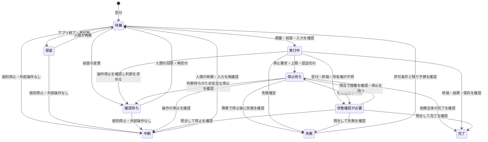

# 実行状態・順序制御・再実行・復旧

[設計 Issue](https://github.com/Kurarowa305/scene-craft/issues/7)。2026-10-13 着手、2026-10-17 第3ラウンドまでの判断を利用者と合意した。2026-10-18、状態遷移図と主要な異常系を含む領域全体を利用者が最終承認し、設計を確定した。本実装・実機検証の完了を意味しない。

## 責務と前提

実行管理は依頼の受付・順序・停止・制作操作の照合・再実行予算を担当する。制作管理は編集案・採否・保護指定、保存モジュールはファイル実体の確定と検証を担当する。Codex 接続と Windows 補助プロセスからの通知だけで制作結果を成功にしない。

根拠は[初期要件](../requirements/initial-scope.md#execution)、[全体設計](application-architecture.md)、[LLM 接続設計](llm-connection.md)、[Blender 連携設計](blender-integration.md)、[データモデル](domain-data-model.md)、[用語集](../../GLOSSARY.md)。

## 順序・再実行・起動の契約

### 順序と排他

- 同じ作品の編集・レンダー・採用・復元は順番に実行する。未採用の別の編集案を作る場合も、初期は同じ作品内で並列実行しない。
- 固定済みの保存状態を読む参考調査・振り返りは並行して進められる。入力の内容を変えず、その参照を実行記録へ残す。
- 確認待ちの依頼は、動作中の処理が安全に停止したことを確認できれば作品の実行枠を解放する。後続は開始直前に最新の状態・保護指定・変更範囲を確認する。
- 確認待ちの案に依存する後続は待機する。依存がない後続は進められる。確認への回答を受けた依頼は再び順番待ちへ戻り、開始時に前提を再確認する。
- 現在状態を起点にする依頼は着手直前に入力を固定する。候補の保存状態を明示した修正依頼はその起点を維持する。候補の起点を最新の採用状態へ差し替えない。

### 再実行予算

- 一つの依頼全体で最大2回の再実行を共有する。例えば植物配置のやり直しに1回使った後、照明調整のやり直しに使えるのは残り1回とする。
- 同じ turn 内での失敗した制作操作の修正・やり直しも数える。原因・turn・モデル・プロセスの変更で回数をリセットしない。
- 正常に完了した操作は、検証済みの結果と入力・変更範囲の整合性を確認して再利用する。
- 人間が失敗した処理の再実行を指示しても、元の依頼と累積回数を引き継ぐ。新しい制作指示による追加の修正は別の依頼とする。
- Codex 内部の通信再送は数えず、実行管理から重ねて依頼を送らない。制作操作のやり直しを単なる通信再送や工程名の変更で予算の対象外にしない。
- デザインを維持することと重複操作を防げることを確認できる失敗だけを自動再実行する。デザイン変更・判断不能・結果不明では人間に確認する。手動停止・利用上限・再認証待ち・プロセス終了後は自動再開しない。

### アプリ再起動

- 未着手の待機依頼も保存し、再起動後は保留する。人間が個別またはまとめて再開を指示する。
- アプリを開いただけでは制作操作を始めない。前回の Windows 側操作の終了が不明なら、競合する依頼は開始しない。
- ブラウザの再接続は実行状況の再取得であり、再実行や再開指示として扱わない。

## 停止後の継続と途中成果

### 停止後の再開と予算

- 検証済みの結果を再利用して未着手の処理へ進むだけなら、再実行回数を消費しない。停止した操作をやり直す場合は1回消費する。
- 例として植物配置が完了し照明調整を停止した場合、植物配置は整合性を再確認して再利用できる。照明調整をやり直すときに回数を消費する。
- 結果不明の操作は先に照合する。単に再開したことや照合したことだけでは回数を消費しない。
- 再実行上限を使い切ったら、人間の再実行指示でも同じ処理を繰り返せない。検証済みの結果を使う未着手部分の継続は、依存関係・変更範囲等を満たせば可能。失敗処理を新しい依頼IDで包み直して回数をリセットしない。

### 個別停止と後続

- 停止は依頼ごとに行う。作品全体を停止する機能は設けない。
- 停止した依頼は自動再実行しない。安全な停止を確認したら、その依頼の結果に依存しない後続を開始できる。依存する後続は待機する。
- 停止結果や所有権が不明なら、競合する後続は開始しない。これは不明な処理との競合防止であり、作品全体を停止する利用者向け機能ではない。
- 既存合意のアプリ終了・再起動時の保留とは区別する。

### 依頼失敗時の編集案

- 依頼全体が失敗しても、独立して検証できた編集案は残し、人間が採用・修正できる。依頼の失敗と、完成した案の利用可否を別に記録する。
- 例として植物配置と照明調整の依頼で、植物配置だけが独立して検証済みなら、その案を利用できる。
- 未完成部分と一体でしか判断できない出力は完成した案として扱わない。13種類が揃わないPSDを完成扱いにしない等、Blender連携の出力契約を維持する。
- 検証済みの案でも採用は別の人間の指示で行い、作品の現在状態を自動で切り替えない。

## 状態と遷移

依頼の状態と、実行中の操作・停止理由を分けて記録する。編集案が完成したことと人間が採用したことを別に扱う。

| 依頼の状態 | 意味と開始条件 |
| --- | --- |
| 待機 | 受付済み。実行可能な依頼の受付順に着手し、入力と前提を確認する |
| 実行中 | 依頼の処理を進めている。制作操作の開始前に停止・世代・排他・予算を確認する |
| 確認待ち | 前提変更やデザイン判断への回答を待つ。操作が止まったことを確認してから実行枠を解放する |
| 停止待ち | 停止要求を保存済み。新しい操作を開始せず、現在の操作の安全な停止・終了を確認する |
| 保留 | 待機依頼をアプリ終了・再起動後の再開許可待ちとして保存している |
| 中断 | 手動停止・利用上限・認証・プロセス終了などで継続を止め、動作中の操作がないことを確認した。原因を別に記録する |
| 状態確認が必要 | 受付・実行・終了の結果、または所有権が不明。照合が済むまで競合操作を開始しない |
| 完了 | 必要な処理・結果の検証と記録が揃った。編集案の採用は別に指示する |
| 失敗 | 失敗が確定し、結果と途中状態を記録した。再実行条件を満たせば同じ依頼で待機へ戻る |

状態遷移と停止要求・実行枠・予算の更新は DB 内で一体として記録する。Windows のファイル・プロセス操作と同時に確定するとは仮定せず、開始前の記録と外部の実行記録を照合する。具体的な受付キー・世代・期限は以下に定める。

## 受付・停止・復旧の契約

2026-10-17、第3ラウンドの推奨案を利用者が承認した。以下はその具体化。

### 停止と完了の競合

- 停止要求をDBへ保存すると同時に、その依頼の新規操作の開始許可を閉じる。待機・確認待ち・保留の依頼も個別停止でき、外部操作がないことを確認できれば中断にする。
- 操作の開始許可と停止要求は同じ依頼の下で直列に判定する。開始許可が先に確定した操作は停止対象の実行中操作として追跡し、停止後に次の操作を追加しない。
- Windows側も開始・停止を直列に受け付ける。停止を先に受け付けた操作IDは、遅れて開始要求が届いても起動しない。停止応答は単なる要求受付と実際の停止確認を分ける。
- 停止要求時点ですでに開始を許可した操作は、通信の遅れで直ちに止められない場合がある。編集・保存は安全な境目で止め、専用レンダーは所有権を確認して終了する。停止した依頼から新たな後続操作は始めない。
- 停止と前後して全処理が終わった場合、操作の終端・必要な結果・保存の検証が揃えば依頼は完了とする。停止要求も履歴に残し、停止によって成果を取り消したとは扱わない。一部だけ完了ならその結果を残して中断とする。
- Codexの終端だけで外部操作が停止したとは扱わない。動作中の外部操作と未解決の開始許可がなくなるまで、競合する依頼へ実行枠を渡さない。

### 二重受付・予算と保存タイミング

- ブラウザが送信操作ごとに受付キーを作り、受付キーと内容をDBへ保存する。同じキー・同じ内容の再送には既存の依頼IDを返し、内容が違えば拒否する。停止・再開・確認回答にもそれぞれ受付キーを持たせ、二重クリック等で別の命令を作らない。
- 依頼ID、制作実行ID、論理的な操作IDとその試行IDを分ける。同じ試行IDの通信再送は照合に使い、外部操作を重複起動しない。内容の異なる再送は拒否する。停止した操作のやり直しには新しい試行IDを発行し、元の操作・依頼を参照する。
- 再実行は、失敗・停止したどの操作をやり直すか実行管理が対応付ける。生成スクリプトや工程名が変わっても同じやり直しとして扱う。判別できない新しい操作要求は実行を許可せず確認する。任意コマンド等でこの受付を迂回させない契約はエージェント設計へ渡す。
- やり直す操作の試行ID発行・予算1回の消費・開始予定記録を、依頼状態・停止条件・作品の実行枠と一緒にDBで確定してから外部へ送る。一つのやり直しがturn再開と制作操作の両方にまたがっても同じ試行として一度だけ数える。別の失敗操作のやり直しはもう1回とする。
- 外部へ送る前に落ちても、保存済みの試行IDと予算を維持する。同じ試行の未着手を両側の記録から証明できれば、その試行を人間の再開指示後に実行でき、追加で消費しない。証明できない場合は結果不明として扱う。
- 外部側は試行IDと入力内容、受付・開始予定を永続化してからプロセスを起動する。記録と起動の間で落ちた場合も、受付記録だけで未実行とは判定せず、所有権とプロセスを照合する。
- 作品ごとの実行枠・順番・固定入力・保護指定と変更範囲の参照、確認回答、停止理由、結果参照・終端を保存する。再開や回答後は待機列の末尾へ戻し、実行可能な依頼の受付順で進める。依存待ちは追い越せるが起点を勝手に変更しない。
- ファイル完成とDB更新は別々に確認する。完成記録とハッシュ・必須出力を照合し、同じ試行の終端通知を何度受けても結果を一度だけ登録する。記録が食い違う場合は状態確認が必要とする。

### 世代・所有権・連絡期限

- 同じ管理DBへの書き込みバックエンドは一つに限定する。バックエンド起動ごとに新しい世代識別子を払い出す。作品の実行枠には所有する依頼・実行・世代を対応付ける。世代は制作データやGitの版番号とは別の制御情報とする。
- Windows側でも同じ実行領域を管理する補助プロセスを一つに限定し、現在の世代と試行IDを照合する。古い世代からの開始要求を拒否する。古い結果通知は照合資料として保持し、現在の試行を上書きさせない。
- 新世代への切り替えだけでは実行枠を解放しない。旧プロセスの所有権、停止・終了と出力を照合し、不明なら競合する操作を開始しない。PIDだけで対象を識別しない。
- 双方向に5秒ごとの連絡確認、各受信側の単調時計で最後の有効な連絡から30秒を期限とする。双方の時計時刻の一致や時計変更に依存しない。世代・連絡番号を照合し、古い連絡の再送で期限を延ばさない。
- 30秒で「死亡」とは判定しない。期限切れを記録し新規操作を止める。Windows側は編集・保存を安全な境目で止め、保存済み入力の専用レンダーを終了する。WSL側は状態照合に移り、競合する操作を開始しない。
- 期限切れによる停止は、その世代で連絡が戻っても撤回しない。照合後、人間の再開指示で新しい実行許可を発行する。PCスリープからの復帰も期限切れなら同じ扱いとする。
- 5秒／30秒は合意した設計値であり、実機検証済みではない。保存途中を強制終了する期限として使わない。安全な境目へ進めなければ停止待ちのまま対象を示す。

## 遷移時の共通条件

- 確認が必要になっても外部操作が動いていれば停止待ちを経由する。停止待ちは、要求理由と停止確認後の遷移先を保持する。確認待ち・中断・失敗へ移して実行枠を解放する前に、動作中の操作と未解決の開始許可がないことを確認する。
- 待機から実行中への遷移では、作品の実行枠、依存関係、入力の存在・整合性、最新の保護指定・変更範囲、停止要求と実行許可を確認する。既に固定した候補起点を別の状態へ自動で差し替えない。
- 確認待ちの回答と手動再開は、同じ依頼ID・累積回数を維持して待機列の末尾へ戻す。回答の対象と前提を記録し、後続の変更で回答が適用できなくなったら再確認する。回答だけで即時に制作操作を開始しない。
- 失敗後の自動再実行は、失敗が確定し、残り予算があり、デザイン維持と重複防止を確認でき、手動停止等の再開禁止理由がない場合に限る。それ以外では原因・途中状態・対処案を残す。再実行予算は実際のやり直しの開始予定記録時に消費する。
- アプリ終了時は待機依頼を保留し、実行中の依頼は停止待ちへ移す。予期しない終了後は保存済みの未着手依頼を保留し、実行中・停止待ちだった依頼は照合する。確認待ちの未回答内容、失敗・中断の理由、消費回数を失わない。再起動だけで待機列を動かさない。
- 結果不明から稼働が確認できても自動で続行しない。安全な停止を待ち、終端・結果・保存の照合により完了・失敗・中断へ確定する。確認できない間は状態確認が必要のまま保持する。再認証や利用枠回復だけで再開許可を発行しない。
- 完了済みの依頼を再開しない。完成した案への新しい修正指示は新しい依頼として受け付け、元の案・保存状態と関係付ける。失敗・停止処理のやり直しを追加修正として回数から除外しない。

## 主要な異常系と受け入れ観点

以下は設計上の確認シナリオであり、実装のテスト結果ではない。

| 状況 | 記録と停止・実行枠の扱い | 復旧・継続 |
| --- | --- | --- |
| 二重クリック・受付応答の喪失 | 受付キーと内容を照合し既存の依頼・命令を返す | 同じ依頼・命令を増やさない |
| 外部の受付・開始応答の喪失 | 同じ試行ID、入力と外部記録を照合。未実行を証明できなければ状態確認が必要 | 別の試行として自動再送しない |
| 再実行予定のDB確定直後に終了 | 試行IDと消費済み回数を維持 | 未着手を証明できれば同じ試行を手動再開し、二重に数えない |
| 手動停止の直後にツール要求 | 新規操作の開始許可を拒否。既に許可済みの操作は停止対象として追跡 | 停止確認後は依存しない後続だけ進める。停止した依頼を自動再実行しない |
| 停止と完了通知の競合 | 全処理・保存・結果が検証済みなら完了、停止要求も保持。一部だけなら中断 | 完了済みの操作を再実行しない |
| 確認待ち中に別案を採用・保護を変更 | 停止確認後に枠を解放し、回答後は最新条件を再確認 | 候補指定の起点は維持し、不整合なら再確認 |
| 植物配置のやり直し後に照明で失敗 | 依頼全体の再実行予算を共有 | 残り1回。同一turnや異なるエラーでも回数を維持 |
| 停止後に検証済み結果から続行 | 未着手部分とやり直し対象を区別 | 未着手部分の続行は消費なし、停止した操作のやり直しは1回消費 |
| 依頼失敗時に独立した案だけ完成 | 依頼の失敗と案の完成を別に記録 | 人間がその案を採用・修正できる。未完成の出力は完成扱いにしない |
| 契約枠到達 | 新しいCodex依頼・制作操作を止め、既存操作の安全な停止と途中成果を記録 | 利用枠回復後も人間の再開を待つ。履歴閲覧等は全体設計に従い利用可能 |
| 認証切れ | 再認証が必要な原因を記録し、安全に停止 | 認証復旧・状態照合後も人間の再開を待つ |
| ブラウザ切断 | 実行を継続 | 再接続は保存済み状態の取得だけを行う |
| WSLとの連絡が30秒途絶える | Windows側が新規操作を止め、編集・保存は安全な境目で停止、専用レンダーは終了 | 連絡復旧で停止を撤回しない。照合後に手動再開 |
| Windows補助プロセス障害 | 状態確認が必要とし、所有権とプロセス・出力を照合 | 終了不明なら競合操作を開始しない。保存中を自動強制終了しない |
| PC・バックエンド終了、スリープ後の期限切れ | 新世代でも旧実行の枠を自動解放せず照合。未着手依頼も保留 | 人間が個別またはまとめて再開。アプリ起動だけで操作しない |
| 古い世代の要求・重複終端 | 古い開始を拒否。結果は対応する実行の照合資料として扱う | 現在の試行を上書きせず、成果や予算を二重登録しない |
| 保存中に応答がなくなる | 停止待ちまたは状態確認が必要。最後に検証済みの保存状態を示す | 自動の強制終了期限を設けない。強制終了は人間の明示操作と次回照合を伴う |

## 関連設計への引き継ぎ

[app-serverの機能別分担調査](../research/codex-app-server-ui-capabilities.md)に、turn中断・会話resumeと、外部制作操作の停止・照合・手動再開の境界を記録した。実験thread queueやthread状態も、作品単位の順序・9状態・依頼全体の再実行予算を代替しない。

| 設計 Issue | 本書が定める契約と後続で具体化すること |
| --- | --- |
| [制作データの保存・復元・バックアップ方式を決める](https://github.com/Kurarowa305/scene-craft/issues/6) | 開始予定・完成記録とファイルを照合する。DBとWindowsのファイルを同時確定とみなさない。完成記録の物理形式、コピー確定、バックアップ中の整合性は保存設計で具体化 |
| [編集案の採用と保護指定の適用方法を決める](https://github.com/Kurarowa305/scene-craft/issues/8) | 作品単位の排他、開始直前の前提確認、候補起点の維持、独立した途中成果の利用。対象ID・保護指定の評価、案の依存判定・競合・組合せ適用を具体化 |
| [工程別エージェントの入出力とツール契約を決める](https://github.com/Kurarowa305/scene-craft/issues/9) | 依頼・操作・試行ID、同一turn内も含む予算強制、停止後の新規操作拒否。モデルが操作を改名しても受付を迂回できないツール契約と各工程の検証を具体化 |
| [専用アプリの画面と制作・記録の導線を決める](https://github.com/Kurarowa305/scene-craft/issues/12) | 個別停止、停止待ちと状態不明、保留と再開、失敗した依頼の途中成果を区別する。作品全体を停止する機能は追加しない。表示名・画面配置は画面設計で具体化 |
| [テスト境界・診断情報・初期版の受け入れ手順を決める](https://github.com/Kurarowa305/scene-craft/issues/14) | 上表の異常系をDB・外部プロセス・画面をまたいで検証。5秒／30秒、スリープ後の経過時間検出、起動・停止の競合、実プロセス所有権の照合を実機確認 |

受付キー・制御記録の具体的なスキーマ、通信ファイルの形式、排他のOS実装は、この契約を保って実装仕様へ落とす。固定入力を読む参考調査・振り返りの並行実行も、同じCodexの実行中turnへ別の依頼を割り込ませない接続単位とする。制作操作や採用等の書き込みへ進む場合は作品の実行枠を取得する。

## 根拠と合意履歴

- 第1ラウンド: [作品単位の排他・確認待ち・再実行予算・再起動後の保留](https://github.com/Kurarowa305/scene-craft/issues/7#issuecomment-6138219127)。
- 第2ラウンド: [停止後の予算・個別停止・独立した途中成果](https://github.com/Kurarowa305/scene-craft/issues/7#issuecomment-6234573831)。
- 第3ラウンド: 2026-10-17、このチャットで停止と完了の競合、二重受付・予算の永続化・待機列末尾への再受付、世代・所有権・5秒／30秒の連絡期限の推奨案をすべて承認。
- Gitの参照・版管理と配置の根拠は [ADR 0001](../adr/0001-git-authoritative-versioning.md)、[ADR 0002](../adr/0002-short-lived-branches-and-human-validation-choice.md)、[ADR 0004](../adr/0004-codex-app-server-runtime.md)、[ADR 0005](../adr/0005-wsl-runtime-and-windows-production-files.md)。

2026-10-18、利用者が「この内容で確定」と最終承認した。設計Issueの解決と資料公開の対象は本書の設計契約とする。本実装・異常系の動作確認と実機受け入れは後続へ引き継ぐ。
