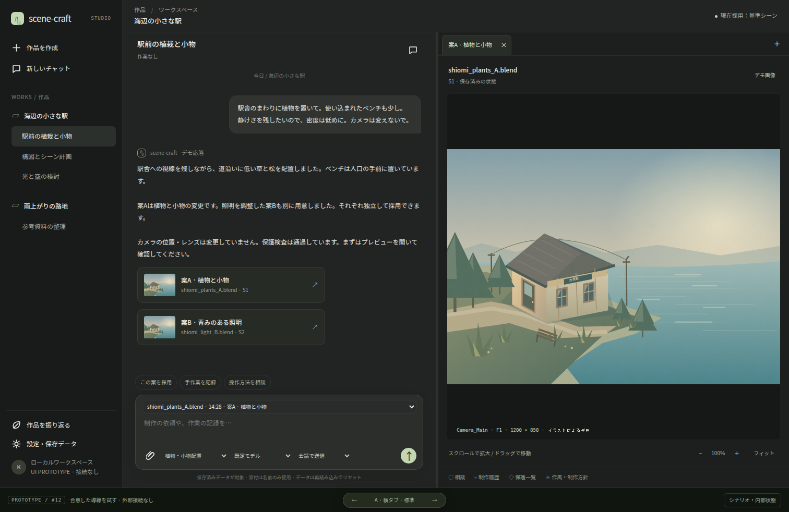

# 画面・制作導線のプロトタイプ

[設計 Issue](https://github.com/Kurarowa305/scene-craft/issues/12)と[画面設計の草案](../../user-interface.md)を、設計確定前に操作して確認するための使い捨てプロトタイプ。`prototype/user-interface-12`ブランチに保存する。本実装へそのまま取り込むコードではない。

確認する問いは「作品ごとのメインチャットと右側のタブを使って、制作・成果物確認・相談・手作業の記録を自然に行えるか」。草案の3領域を維持し、タブの整理方法をA・B・Cで比較できる。



## 別端末で起動

リポジトリを取得済みなら、リポジトリのルートで以下を実行する。作業中の変更がある端末では、別のクローンで確認すると既存の作業と干渉しない。

```sh
git fetch origin
git switch prototype/user-interface-12
python3 docs/design/prototypes/user-interface/serve.py
```

Windowsでは最後のコマンドを次に置き換える。

```powershell
py docs/design/prototypes/user-interface/serve.py
```

ブラウザで **http://127.0.0.1:8120/** を開く。Python 3の標準ライブラリだけを使い、Node.js・npm・APIキーのインストールや設定は不要。ポートを変える場合は`--port 8121`を付ける。終了はターミナルで`Ctrl+C`。

未取得の場合は、先にクローンする。

```sh
git clone --branch prototype/user-interface-12 https://github.com/Kurarowa305/scene-craft.git
cd scene-craft
```

Pythonがない端末では、同じフォルダーの`index.html`をブラウザで直接開く方法でも動作する。フォルダー内のHTML・CSS・JavaScript・SVGを一緒に取得すること。初回表示にも外部サービスやCDNへの接続は不要。

起動したPC以外のブラウザから同じサーバーを見る場合は、次のように起動し、そのPCのLAN IPとポートへアクセスする。ファイアウォールやWSLの転送設定は端末側の環境に従う。

```sh
python3 docs/design/prototypes/user-interface/serve.py --bind 0.0.0.0
```

## 試せること

1. **案の確認と採否**：メインの返答中の案A・案Bをクリックする。右側にタブが開き、同じ案は既存タブを使う。画像はスクロールで拡大、ドラッグで移動できる。成果物を選び「この案を採用して」とメインへ送ると、現在採用の表示が変わる。採否ボタンは置かない。
2. **サイドチャット**：右下の「相談」かメイン上部の会話アイコンから開く。「ベンチをBlenderで動かす方法は？」等を入力する。「採用して」「記録して」と依頼しても制作や記録は変更しない。閉じて開き直すと、そのページ内の相談は残る。
3. **手作業の記録**：入力欄のプルダウンで成果物を選び「ベンチを手修正したので、ここまでを記録して」と送る。ファイル・画像を選択して添付名を表示することもできる。元の成果物とは別の手修正記録を作る模擬動作。
4. **停止と明示再開**：右下の「シナリオ・内部状態」で「制作を開始」。入力欄右下の停止ボタンを押すと、停止待ちを経て中断になる。「続けて」とメインへ送って再開する。デモの制作は自動完了しないため、停止まで任意の時間操作できる。
5. **利用上限とプレビュー失敗**：デモ操作で「LLM利用不可」と「プレビュー失敗」を切り替える。利用不可中もメインの「記録として送信」や設定のバックアップを操作できる。画像が未取得でも記録は残り、未取得タブから後で画像を補う流れを模擬する。
6. **保護と依頼限定許可**：「保護一覧」タブで継続的に保護を削除できる。「保護の競合」シナリオではメインで「今回はカメラの位置変更を許可して」と回答する。今回だけの許可では一覧の保護は消えない。
7. **履歴と復元・派生**：「制作履歴」タブで節点にホバーして理由を確認する。選択した節点をメインへ参照として添え、「ここに戻して」→「復元を実行して」、または「ここから別作品を作って」と指示する。追加の手修正等も履歴の下に表示する。
8. **作品・会話・振り返り**：左側から作品と会話を作成できる。「作品を振り返る」で対象作品と履歴範囲を選ぶ。複数作品は作品横断の専用会話として表示し、対象を明示する。
9. **作風と保存データ**：作風タブで版を選び、作品へ適用する。設定にはバックアップ・復元・実体削除・版参照・移行の模擬画面を用意する。採用中の実体は削除できず、削除済みの実体はプレビューからも利用不能と分かる。

チャットとタブの境界はドラッグで幅を調整できる。狭い画面では上部の`⇄`でチャットとタブを切り替える。

右下のデモ操作には、作業状態・参照・採用状態などを確認する表示がある。デモの初期化、またはページの再読み込みですべて初期状態に戻る。

## タブ構成の3案

| URL | 変化する構造 |
| --- | --- |
| `http://127.0.0.1:8120/?variant=A` | 草案の標準。右側上部の横並びタブ |
| `http://127.0.0.1:8120/?variant=B` | 右側領域の中に縦のタブ一覧を置き、長いタブ名を一覧から選ぶ |
| `http://127.0.0.1:8120/?variant=C` | 種類別の入口を上に置き、開いているタブは折り返すチップ状に整理 |

下部の切替バーか左右の矢印キーで切り替えられる。入力欄にフォーカスがある間は、矢印キーを入力操作に使う。レイアウト切替はURLに残るが、制作状態はメモリ上のみ。切替バーと内部状態パネルはプロトタイプ専用である。

## デモの範囲と限界

- LLM・Blender・Photoshop・Git・データベースには接続していない。返答はキーワードに対応した定型応答。自由な文章の意味理解や実制作の動作検証ではない。
- サンプルの作品・保存状態・ファイル名・Git参照・容量は表示用。`scene.svg`はコードで描いた説明用イラストで、`.blend`の実レンダーではない。ファイル添付は名前だけを使い、実ファイルを読み込んだりアップロードしたりしない。
- 採否・保護・復元・バックアップ・削除・公開・形式移行はメモリ上の模擬動作。実ファイルの読み書き・削除・実際のGit通信は行わない。バックアップ復元先の検証や異常系の実処理も未実装。
- カメラ条件の検査、画像生成・キャッシュ、保護検査、依存関係の判定、任意の部分採用・組合せは行わない。初期の案A・案Bを独立した変更として扱う例を用意している。
- 状態アイコンは仮のもの。ChatGPTアプリと完全に一致するデザインや挙動を確認したものではない。
- 設計の確認用であり、画面レビュー用のエージェントや本実装の受け入れ完了を意味しない。設計Issueはプロトタイプの確認後も、利用者が設計を確定するまで開いたままにする。

## 作成時の確認

JavaScript構文、Python起動、ブラウザ上でのタブ再利用・画像拡大・会話による採否・相談の権限制限と再表示・保護解除・履歴参照と復元・停止／再開・状態不明時の再開保留・LLM利用不可時の記録とプレビュー失敗／補完・保存管理・作品／会話作成・振り返り・3案の切替を確認した。1512px・1024px・390px幅の表示、HTML直接起動、複数作品の振り返りの対象表示も確認し、これらの操作中のブラウザのJavaScriptエラーはなかった。

実際のファイル操作・外部アプリ・LLM接続・別端末上の動作は未検証。使いやすさについての利用者の評価は未実施。
