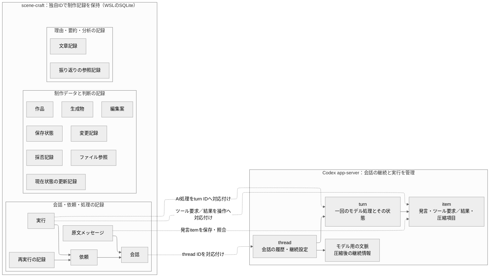

# Codex app-server と画面機能の分担

確認日：2026-10-31（日本時間）。[画面機能と独自実装の分担調査](https://github.com/Kurarowa305/scene-craft/issues/26)の結果。機能棚卸しと根拠の確認を対象とし、設計変更の合意・本実装・受け入れの完了を意味しない。

app-server は会話・推論・ツール呼び出しの基盤として利用できる。作品、保存状態、採否、保護、制作ファイルとその実行結果、画面自体は scene-craft／通常プログラムが担当する。既存の Codex 管理認証・WSL 配置・ChatGPT 契約枠・明示再開の選択は変更しない。

## 機能別対応表

各機能について、app-serverから利用する処理と、scene-craftで用意する画面・保存・制作処理を説明する。これは実装する責務の整理であり、製品の実装完了を示すものではない。API・根拠資料・検証結果・未確認事項は、対応表の後にまとめる。

| UI機能・利用者操作 | app-serverで実現する部分 | scene-craftで独自に実装する部分 | 接続する外部ツール・通常プログラム |
| --- | --- | --- | --- |
| 作品を作成し既存ファイルを取り込む | 会話を実行するthreadを作成し、projectとthreadを関連付ける仕組みを提供する。projectの名前や作業場所など、会話をまとめるための情報を保持できる。 | 作品IDを発行し、作品名・制作意図・選択した作風を保存する。空の作品を始める場合と既存データを取り込む場合を分け、取り込みでは制作ファイルと依存素材を管理下へコピーして、最初の保存状態と取り込み記録を作る。 | SQLite、ファイルコピー・ハッシュ・依存確認 |
| 作品別の複数チャット・作成・一覧 | 複数のthreadを作成して個別に管理し、条件やページを指定して一覧を取得できる。各threadの識別子や名前、会話の状態を返す。 | チャットを作品または振り返りに所属させ、左側の一覧に表示する。初回送信前の空チャットも独自に保存してすぐに開けるようにし、並び順とモデル選択を保持する。作品を開き直した際は、所属する会話とapp-serverのthreadを対応付ける。 | SQLite |
| チャットを保存し開き直す | threadに保存された会話を読み戻し、既存の会話を継続できる状態に戻す。長い履歴はturnやitemに分けて取得できる。 | 独自の会話IDとthread IDを結び付け、原文・作品・依頼・成果物の参照を保存する。画面を開き直したときは保存済みの会話を表示し、会話の継続が必要になった時点でapp-serverへ接続する。Codex内部の継続データを移行しない場合も原文を見返せるようにする。 | SQLite、HTTP/SSE |
| 最初のリクエスト後にLLMがタイトル命名 | タイトルを考えるためのモデル呼び出しと、生成した名前をthreadへ設定する処理に利用する。設定済みの名前を保存し、取得や変更通知を通じてクライアントへ返す。 | 初回送信を契機に命名を依頼し、返されたタイトルを確認して会話へ保存する。命名前は暫定タイトルで表示し、命名が失敗・中断しても会話原文や手作業の記録を保存できるようにする。 | SQLite |
| 会話の開始・継続・本文ストリーミング | 利用者の入力からturnを実行し、モデルの本文を生成途中から順に通知する。本文・ツール呼び出しなどのitemと、turnの開始・完了・失敗を通知する。 | ブラウザの送信を依頼として保存し、対応するthreadへ入力を渡す。通知を会話・依頼と対応付けて保存し、ブラウザへ配信する。途中の本文、turnの終了、制作結果の確定をそれぞれ表示し、重複通知で記録を増やさない。 | Node.js/Fastify、SQLite |
| 状態アイコン・進捗・確認待ち | threadとturnの実行状態、各itemの進捗、操作承認を待っている情報を通知する。モデルやツールがどの段階にあるかをクライアントが把握するための情報源になる。 | LLMの状態と、待機中の依頼・外部レンダー・保存処理・停止処理の状態を合わせて管理する。内部の9状態を画面の4分類へまとめ、未解決の確認事項を優先してアイコンを表示する。詳しい進捗・待機理由・対処はチャット内に表示する。 | 実行管理DB、Windows補助プロセス |
| 入力欄から現在の作業だけ停止 | 指定したthreadの実行中turnへ中断を要求し、そのturnが中断したことを終端通知で返す。 | チャットで現在進めている依頼と制作操作を特定し、新しい操作の開始を止める。Windows側の実行処理にも停止を伝え、安全に止まったことと保存済みの出力を照合する。停止待ちと停止完了を区別し、対象外のチャットの処理を維持する。 | Windows Blender/Python、所有権付きプロセス管理 |
| 「続けて」で再開・結果不明を照合 | 既存threadを再び利用できる状態にし、保存された履歴を取得する。再開指示を新しいturnとして受け取り、会話を継続する。 | 明示メッセージがどの依頼の再開かを特定し、元の依頼IDと再実行回数を引き継ぐ。結果が不明な場合はturn・制作操作の記録・実体を照合してから次の処理を許可する。認証回復や再接続だけでは制作を再開しない。 | SQLite、制作操作ログ、実体ハッシュ |
| 送信時にモデルを選択・記録 | モデルの一覧と対応する設定情報を返し、threadやturnに指定されたモデル・推論設定で実行する。サービスによるモデル切替が通知された場合は、その情報をクライアントへ返す。 | 使用するモデルを入力欄で選べるようにし、送信時に要求した設定を依頼へ固定する。要求値・有効な設定・通知から判明した実行モデルを区別して記録する。使用できない場合は利用者へ変更を求め、自動で別モデルを選ばない。 | SQLite |
| 直前のチャットのモデルを新規へ引き継ぐ | 新しいthreadや次のturnへ、クライアントが明示したモデルを設定できる。同じthreadで継続して使うモデルの設定を保持する。 | 直前のチャットで利用者が選んでいたモデルを保存し、新規チャットの初期選択へ引き継ぐ。既存チャットの選択はそのまま保持し、会話内でモデルを変更した場合は次の依頼から適用する。 | SQLite |
| エージェント選択と「なし」 | 指示文・スキル・ツール設定を受け取り、それらに従って会話やツール呼び出しを進める実行基盤を提供する。 | 工程別のエージェント定義と選択欄を用意し、実際の送信時に選ばれた工程・定義のGit版・実行設定を依頼へ記録する。新規チャットは「なし」で始め、選択だけでは工程を実行しない。工程を切り替えても、過去の依頼や実行設定を変更しない。 | Git、契約検査 |
| メインと並行する相談専用サイドチャット | メインとは別のthreadで会話を実行し、それぞれの入力・応答・実行状態を個別に扱う。 | 右側のタブに相談用の会話を開き、メインと別の会話ID・保存先・停止対象として管理する。相談の履歴は閉じた後も保存して開き直せるようにし、タブを閉じる操作と実行停止を分ける。 | SQLite |
| 相談へ初期文脈を継承 | クライアントが渡した文章や画像を、相談用threadの指示・入力として利用する。会話を分岐させる機構も提供する。 | 相談を開いた時点の制作意図・採用状態・メインの話題・選択成果物をまとめ、参照元とともに固定して渡す。その後のメインの発言は自動転送せず、相談の原文・要約と、実際に参照した記録を保存する。 | SQLite、文脈組立 |
| 相談から制作・採否・記録を禁止 | sandboxや操作承認の方針、利用するツールの設定を通じて、モデルの実行範囲を制御する仕組みを提供する。 | 相談には制作操作・採否・保護変更・確定記録用のツールを公開しない。バックエンドでも呼び出し元の会話権限を検査し、相談から更新要求が届いても拒否する。記録として送信するUIや、メインへ依頼を確定して受け渡す経路も設けない。 | 制作ツール受付、SQLite |
| 原文・要約・文脈圧縮 | 同じthreadで会話を続けるための文脈を管理し、長くなった会話を圧縮する。会話履歴の取得と圧縮の進行通知を提供する。 | 会話原文を保存し、対象メッセージと参照元を持つ要約を別の文章記録として作成する。訂正前の要約を残し、未要約の範囲も管理する。作品の最新情報は独自の確定記録から補い、他会話への引き継ぎや振り返りに使った入力を追跡する。 | SQLite、要約生成 |
| コンピューターから画像添付 | URLやローカルパスで渡された画像をモデル入力として扱う。モデルが受け取る入力の種類に関する情報を返す。 | OSのファイル選択から画像を受け取り、管理下へコピーして会話・作品・依頼へ関連付ける。Windows側のファイルをWSLのapp-serverが読める参照へ変換し、添付画像の表示と元ファイルの管理を行う。 | ファイルAPI、Windows/WSL橋渡し |
| `.blend`・PSD/PSB等を添付し成果物選択 | 制作ファイルの識別情報や、外部ツールで抽出した文章・画像を会話入力やツール結果として扱う。threadに関連情報を添付する仕組みも提供する。 | 制作ファイルを受領して管理下へコピーし、ハッシュと依存素材を記録する。成果物の選択欄にはファイル名・時刻・元の案・保存状態を表示する。LLMへは対象を特定する参照と必要な抽出情報を渡し、制作実体は専用の処理で読み取る。 | SQLite、Blender/Python、ファイル解析 |
| 編集案・保存状態へのリンクと右側タブ | モデルの本文やツール結果として、クライアントが表示する文章・成果物参照を返す。 | 編集案・保存状態・ファイルの固定IDをリンクへ変換し、押された対象を右側のタブで開く。同じ対象は既存タブを選び、別の成果物は新しいタブに表示する。元の枝が更新されてもリンク先を変えず、削除・欠落している実体はその状態を示す。 | SQLite、ローカル成果物API、React |
| プレビュー生成・取得・画像拡大移動 | 会話からプレビュー作成を求める場合に、ツールの呼び出しと結果の受け渡しを仲介する。 | 固定した制作ファイルと生成条件から既存画像の再利用を判断し、必要なら通常プログラムで画像を作る。画像配信と拡大・移動を実装し、カメラ・フレーム・解像度を表示する。生成に失敗しても本文と制作ファイルの記録を保存し、後から画像を補えるようにする。 | Windows Blender、通常Python、画像配信API |
| 会話による採用・不採用・理由 | 会話の指示を解釈し、対象や操作内容を文章・構造化出力・ツール呼び出しとして返す。 | 対象の案と範囲を特定し、採否の指示・適用中・適用済み・失敗を別々に記録する。制作結果を確認して現在状態を切り替え、会話にも確定した結果を表示する。理由は任意で保存し、未入力を推測で補わず、明示済みの同じ指示に重ねて確認を求めない。 | SQLite、制作ツール、実体検証 |
| 部分採用・複数案の組合せ・候補追加修正 | 指定された案や修正範囲を文脈として受け取り、変更の提案と外部ツールへの操作要求を生成する。 | 独立した変更単位と依存関係を管理し、部分採用できる範囲を扱う。複数案を組み合わせる際は実際の結果を生成・検証して提示し、寄与元と保持する手修正を残す。未採用案への追加修正では、指定された保存状態を起点として維持する。 | Blenderスクリプト、SQLite |
| 手作業記録・理由／変更要約の訂正 | 利用者の説明やツールからの情報を基に、変更内容の整理・要約を行うモデル呼び出しに利用する。 | 保存済みの制作ファイルを取り込み、変更前後・元の案・作業内容・理由を結び付ける。指示した人間と実際の変更者を区別し、理由や要約の訂正は以前の文章・記入者・時刻を残して追加する。Photoshopでの保存と書き出しは人間が行い、その結果を登録する。 | SQLite、ファイルコピー・ハッシュ |
| LLMなしの「記録として送信」 | この操作ではapp-serverを呼び出さず、モデルによる解釈・整理・要約を待たずに記録する。 | 対象・本文・添付を通常の保存処理へ直接渡し、会話原文と手作業の記録を確定する。相談としての送信と区別し、要約や命名が未完でも記録を保持する。後からLLMで整理する場合は、保存済みの原文を入力として使う。 | SQLite、通常プログラム |
| 保護指定・一覧から解除・依頼限定許可 | 会話から対象・項目・変更理由を整理し、必要な確認や制作ツールへの要求を生成する。 | 保護する対象と項目を保存し、一覧表示・継続解除・依頼限定の一時許可を扱う。採用時に最新の保護と実際の直接・間接変更を照合し、共有材質などへの影響も調べる。違反または検証不能な案の採用を拒否し、理由をチャットで説明する。 | Blender検証、SQLite |
| 左から右への制作履歴ブランチグラフ | 会話のthread・turn・itemを取得する機構を提供する。会話上の指示や応答を、制作履歴の関連記録として参照するために利用する。 | 保存状態を節点、変更記録を枝として構成し、編集案の分岐・手修正・AI修正・採用後の継続を左から右へ描く。理由のホバー表示、節点の選択固定、成果物リンク、チャットへ参照を添える操作を実装する。 | SQLite、Reactグラフ描画 |
| 保存状態への復元・別作品への派生 | 復元や派生を求める会話を扱い、対象を確認する応答や外部ツールへの要求を生成する。 | 復元元と直前の状態を特定し、未登録の手修正を記録して必要な実体を調べる。復元では後続履歴を残したまま新しい記録を作り、派生では起点を参照する独立した作品とファイルを作る。依存不足・破損がある場合は理由を示して開始を止める。 | SQLite、ファイル操作、Blender |
| 全履歴を対象に単作品／複数作品を振り返る | 分析用の会話を実行し、渡された履歴・要約・画像と、ツールから追加取得した情報を基に分析を生成する。 | 対象作品を選び、採用状態に関係なく全履歴を対象として情報を取得する。実際に分析が参照した作品・保存状態・採否・文章・実体を固定し、不足や理由未入力を示す。複数作品の振り返りは専用会話に保存し、後日の根拠訂正と過去の分析を区別する。 | SQLite、文脈組立、Git |
| 作風・制作方針の表示と最新表示 | scene-craftが固定した作風や制作方針を、指示・会話入力としてモデルへ渡す経路を提供する。 | 使用中の内容とGit版を表示し、版の選択欄で最新版に「最新」と表示する。選択中の過去版は維持し、未選択・保留・不採用・採用済みを区別する。モデルへ渡す際は、作品の制作意図と採用済みの制作方針を整理して入力へ固定する。 | Git、SQLite |
| 方針の項目別採否・編集・保留 | 振り返りから作風の傾向や制作方針の案を生成し、会話による編集・採否の指示を解釈する。 | 仮説の項目ごとに根拠と人間の判断を保存し、採用・編集・保留を扱う。採用内容をGitへコミットして成功を確認し、作品への適用は別の操作として扱う。AIによる観察と、人間が採用した方針の区別を維持する。 | Git、SQLite |
| 定義・作風のGit版固定・作品へ適用・公開 | Git操作を行うシェルや外部ツールの呼び出し経路と、固定した定義内容を実行へ渡す仕組みを提供する。 | 定義と作風それぞれのフルコミットハッシュ・保持用タグ・使用内容を記録する。版変更では旧版・新版・理由と互換性を扱い、待機中や実行中の依頼への適用を制御する。ローカル保存・作品への適用・GitHubへの明示公開を分け、保存状況と確認時刻を表示する。 | Git/gh、SQLite |
| 認証・利用上限・再認証表示 | Codex管理のログイン、認証情報の保存・更新、ログイン取消・ログアウトを扱う。アカウント状態や利用枠を取得するAPIと、それらの更新通知を提供する。 | scene-craft用のCodex保管先を分け、認証・利用上限・通信失敗を分類して対処を画面へ示す。費用条件の確認は利用者が担う既存方針を維持し、利用枠取得失敗だけでは送信を保留しない。上限や再認証待ちでは途中成果を保存し、回復後も人間の再開を待つ。 | Codex管理認証、ブラウザログイン |
| 再接続・失敗・再実行 | 通信やモデル実行のエラー、内部再試行の情報、turnの終端を通知する。保存した会話を再接続後に読み戻し、明示された入力から継続できる。 | 依頼全体の再実行回数を保持し、同じturn内の制作操作のやり直しも含めて最大2回に制限する。通信再送とは分けて数え、世代・所有権・操作記録・出力を照合して二重実行を防ぐ。停止・利用上限・結果不明などの理由に応じて、自動再開を抑止する。 | 実行管理DB、Windows補助プロセス |
| ブラウザ終了後の継続・再表示 | ブラウザとは別のローカルプロセスとしてthreadとturnを管理し、接続中のバックエンドへ進捗を通知する。 | Windowsの起動管理とWSLバックエンドをブラウザから独立させ、画面を閉じても処理を維持する。進捗・途中成果・結果を保存し、画面を開き直すと保存済み情報と以後の通知を表示する。PCや実行プロセスが終了した場合は照合と明示再開へ進む。 | Windows起動管理、Node.js、HTTP/SSE、SQLite |
| LLM利用不可時の閲覧・プレビュー | この経路ではapp-serverへの接続やモデル呼び出しを前提にしない。 | 独自に保存した会話・制作履歴・成果物を表示し、固定した制作ファイルから通常プログラムでプレビューを生成する。LLMが使えない間も手作業の記録と設定画面を利用でき、失敗や不足は対象の処理に対応付けて表示する。 | SQLite、ファイルAPI、Windows Blender/Python |
| ローカル保存・全体バックアップ・復元・移行 | Codex自身の会話継続に使うデータを保存し、同じ環境での履歴取得やthread再開に利用する。 | 作品DB・制作ファイル・依存素材・会話・履歴の整合性を保って書き出す。安全な停止と保存を確認してからバックアップし、復元は空の保存先へ行う。不足と破損を分け、形式移行では退避先と結果を記録する。認証・Codex内部継続データ・Git実体は製品バックアップに含めない。 | SQLite、manifest・ハッシュ、コピー・移行プログラム |
| 大容量実体の明示削除・履歴維持 | thread自体を削除するAPIを提供する。制作ファイルの実体削除はscene-craftの保存管理で扱う。 | 対象の容量と影響する保存状態を示し、人間の明示操作で実体を削除する。採用中・実行中・他作品と共有する実体を保護し、会話・理由・採否・分岐・当時の参照は残す。削除済み・欠落・破損を区別して、復元や派生に使える状態を表示する。 | SQLite、参照検査、ファイル削除 |
| Windows Blender・通常スクリプト・制作ツール接続 | シェル・MCP・動的ツールを通じて外部処理を呼び出し、その結果をモデルへ返す。会話・turn・ツール要求を結び付ける通知を提供する。 | 制作ツールの引数・権限・保護・試行IDを検査し、Windows補助プロセスへ操作を渡す。Windows/WSLのパス変換、所有権、連絡期限、停止と照合を実装する。出力実体と必須条件を検証してから保存状態や編集案を確定し、結果を会話へ返す。 | Windows補助プロセス、Blender、Python、PSD/PSB処理 |
| 一般Web検索・参考画像を調べる | Web検索ツールの呼び出しと、検索・ページ参照などのitemを会話で扱う。取得した画像をモデル入力として渡す経路も提供する。 | 検索目的と制作意図を結び付け、出典・確認日・参考にする要素・人間の選択を保存する。画像を保持できる条件を確認し、保存できる実体は管理下へコピーする。参照URLだけを残した場合は画像未保持として扱い、選択した資料を次工程へ渡す。 | Web取得プログラム、SQLite、ファイル保存 |
| Poly Haven／ambientCG・指定フォルダー検索と素材取得 | MCPや動的ツールを介して、サービス別APIやローカル検索を行う外部処理を呼び出す。候補情報や取得結果を会話へ返し、人間の選択を扱うために利用する。 | サービス別の検索・ページ取得・キャッシュと、指定フォルダー内の検索を実装する。候補の出典・利用条件・品質を示し、人間が選んだ素材と依存ファイルを管理下へ取得する。Blenderへ取り込んだ結果を編集案として提示し、選択・取得・採用を別々に記録する。 | Poly Haven/ambientCG API、HTTPクライアント、ファイル検索、Windows Blender |

## app-serverの管理情報とデータモデルの対応

[データモデル設計](../design/domain-data-model.md)の15エンティティを、app-serverとの接続に対応する記録と、制作データ・判断を保持する記録に分けて示す。scene-craftのエンティティはそれぞれ独自の永続IDを持ち、Codexのthread／turn／item IDは接続対応記録で結び付ける。

実線はapp-server内の履歴構造と、図中に示すscene-craftの所属関係を表す。点線は両者を照合するための対応を表し、同じデータを共有することや一対一の関係を意味しない。エンティティ間の参照は、対応を説明するために必要なものだけを描いている。



**会話・原文メッセージとthread・item。** scene-craftの会話には、所属作品や振り返り対象、モデル選択を保持する。app-serverのthreadは、その会話でモデルとのやり取りを継続するために使う。利用者とAIの発言itemは原文メッセージへ保存し、会話ID・メッセージIDとCodex側の識別子を照合できるようにする。一つのturnには発言以外のitemも含まれ、内部推論やツール項目をすべて原文メッセージへ変換する前提は置かない。LLMなしの記録送信や外部取り込みの原文は、Codex側のitemがなくても保持する。バックアップ移行でCodex内部データを引き継がない場合も、scene-craftの会話IDと原文を保持する。

**依頼・実行・再実行の記録とturn・ツールitem。** 依頼は制作目的と停止・再実行予算の単位であり、その下にAI処理やWindows制作操作の実行を記録する。AI処理の実行にはturn ID、外部操作の実行にはツール要求・結果の対応とWindows側の実行記録を結び付ける。一つの依頼が複数turnへまたがる場合も、同じturn内で制作操作をやり直す場合もあるため、依頼・実行・turnを一対一に固定しない。再実行の記録は依頼IDと対象実行を参照し、turnの変更やCodex内部の通信再送だけで制作の再実行回数を決めない。LLMを呼ばないプレビュー生成等の実行もscene-craft側で記録する。

**文章記録・振り返りの参照記録と圧縮後の文脈。** app-serverはモデルが会話を継続するための文脈と圧縮処理を管理する。scene-craftは、理由・要約・制作意図を文章記録として保存し、訂正前の文章と対象原文への参照を残す。振り返りの参照記録には、分析で実際に使った保存状態・採否・変更・文章などのIDを固定する。これらの根拠付き記録はscene-craftが管理するため、図では圧縮後の文脈からの直接対応線を引いていない。

**制作データと判断の8エンティティ。** 作品、ファイル参照、生成物、保存状態、変更記録、編集案、採否記録、現在状態の更新記録は、scene-craftが制作ツールの結果と人間の判断を基に確定する。ファイル参照が指す`.blend`・PSD/PSB・素材・プレビューの実体はWindows側に置く。app-serverのツール結果や返答は実行の照合資料として使い、検証済みの実体・完成判定・採否の確定結果を各エンティティへ記録する。会話の分岐、turn完了、操作承認だけで作品の保存状態や採用状態を更新しない。

図はデータモデル設計のエンティティと会話実行基盤の対応に絞っている。app-serverのproject、認証、モデル一覧、設定などの補助情報は省略しており、projectを利用する場合も、作品の永続IDと制作記録はscene-craftで保持する。接続対応記録は既存設計で定めた参照の役割を説明するもので、16番目のドメインエンティティやSQLテーブルを追加する判断ではない。

## 根拠資料と確認範囲

- **D**：[公式 app-server 文書](https://learn.chatgpt.com/docs/app-server)。確認時点の更新される文書。API 名の記載だけでは実機確認済みを意味しない。取得URLは `https://learn.chatgpt.com/docs/app-server.md`、本文SHA-256は `f879715bb0d440db60b71e7a5bfe1258d045520feabe3fc6b11847100c8d064b`。公開文書には版固定がないため、追跡可能な公式ソースの固定コミットとPも併用する。
- **S**：公式 `openai/codex` main の確認コミット `67f0994b532b8740f14b5b738af7b7b2a915b1d6`。導入済み `0.166.0-alpha.5.1` と同一ビルドであることは確認していない。最新ソースにあることを導入版の動作保証にしない。
- **S-thread**：[thread.rs](https://github.com/openai/codex/blob/67f0994b532b8740f14b5b738af7b7b2a915b1d6/codex-rs/app-server-protocol/src/protocol/v2/thread.rs)。`ThreadStartParams`、`ThreadSettingsUpdateParams`、resume/fork 設定。
- **S-turn**：[turn.rs](https://github.com/openai/codex/blob/67f0994b532b8740f14b5b738af7b7b2a915b1d6/codex-rs/app-server-protocol/src/protocol/v2/turn.rs)。`TurnStartParams`、`UserInput`。
- **S-project**：[project.rs](https://github.com/openai/codex/blob/67f0994b532b8740f14b5b738af7b7b2a915b1d6/codex-rs/app-server-protocol/src/protocol/v2/project.rs)。project は id/name/roots/metadata/並び順等を持つ。scene-craft の作品・保存状態・採否モデルとは区別する。
- **S-title**：[TUI の thread_title.rs](https://github.com/openai/codex/blob/67f0994b532b8740f14b5b738af7b7b2a915b1d6/codex-rs/tui/src/app/thread_title.rs)。TUI クライアントが一時 thread を開始し構造化タイトルを求める実装。これは app-server が各初回 turn 後の命名を無条件に行う証拠ではない。
- **UI**：`docs/design/user-interface.md`、確定元 `403644c75308b50cf886431d020be502474492a8`。試作 `5298534c2939aa44683baa6ebd3ced8285801466` は操作契約の根拠だけであり、app-server 接続の根拠ではない。
- **P**：導入済み CLI `0.166.0-alpha.5.1` が生成した[プロトコル抜粋](evidence/codex-app-server-ui-schema.json)。通常出力と `--experimental` の出力を比較。メソッド一覧、主要型の項目名・必須項目・元schemaのSHA-256、入力型・状態・通知を収録。機能別の根拠に挙げる型・API名は P でも照合したものを使う。通常出力に含まれることを製品の安定保証とは呼ばない。
- **R**：[現行版の非推論RPC結果](evidence/codex-app-server-ui-probe.json)と[再実行コード](evidence/codex-app-server-ui-probe.py)。空の専用 `CODEX_HOME` で確認し、認証・既存会話は読み込まず `turn/start` は送っていない。
- **入力資料**：調査開始時の scene-craft `main` は [`787b620d858c611058f96d361a9ab9bfdcd41830`](https://github.com/Kurarowa305/scene-craft/tree/787b620d858c611058f96d361a9ab9bfdcd41830)。UI本文は上記確定コミットから変更なし。[参考調査・素材設計](../design/reference-and-assets.md)までを含む。`agent-contracts.md` は未作成で、工程別契約を本調査で確定しない。
- **旧実機**：[既存接続検証](codex-app-server-connection-validation.md) の `0.160.0` 検証。turn/画像/動的ツール/resume/圧縮/原文取得/interrupt の確認を再利用できるが、最新版や制作ツールの異常系を保証しない。


## 機能別のAPI・根拠と調査上の留意点

D／S／Pは文書・ソース・型の確認、R／旧実機は実行による確認を指す。仕様上の対応と実機での確認を分け、機能ごとの根拠と制約を以下に残す。

- **作品を作成し既存ファイルを取り込む**：`project/create,list,read,update,move,delete`、`thread/start.projectId`（Pでは両方とも実験）；P、S-project、S-thread。project API はscene-craftの作品作成契約を完成させない。実験APIを採用するか #9／実装仕様で判断。再作成・移行時のID対応を検証
- **作品別の複数チャット・作成・一覧**：`thread/start,list`、実験 `thread/start.projectId`；P、D Threads、S-thread、S-project。`cwd`だけで作品所属を代替しない。Rでは空threadを2件作成しloaded一覧で取得できたが、stored一覧は0件。初回送信前もscene-craft DBへ保存する。既定sourceKindsとpaginationによる一覧漏れも確認
- **チャットを保存し開き直す**：`thread/read,resume`、`thread/turns/list,items/list`；D Threads。Rは同一プロセス内のread/resumeまで成功。再起動後は旧実機のみ。Rの新規threadはpaginatedで、includeTurns=trueはdeprecationNotice。メタ取得＋turns/itemsページングへ。継続データは移行対象外で、消失時も原文を表示
- **最初のリクエスト後にLLMがタイトル命名**：`thread/name/set`、`thread/name/updated`；P、R、D、S-title。app-serverが初回turnだけで自動命名する保証は未確認。TUIの一時thread命名実装はクライアント側。製品のモデル自動切替禁止と矛盾しない命名モデル・費用扱いを #9 で決める。命名未完でも記録を許可
- **会話の開始・継続・本文ストリーミング**：`initialize`→`initialized`、`thread/start,resume`、`turn/start`、`item/agentMessage/delta`、`turn/completed`；D Lifecycle/Events。本文finalとturn成功を区別。旧実機の成功は再利用可、現行版とブラウザ再接続は別途確認
- **状態アイコン・進捗・確認待ち**：`thread/status/changed`（notLoaded/idle/systemError/active、activeFlags）、`turn/started,completed`、`item/*`；D Events。notLoadedは停止や制作完了の証明ではない。過去の失敗を現在アイコンに残さない。複数依頼と外部レンダー待ちを検証
- **入力欄から現在の作業だけ停止**：`turn/interrupt`→`turn/completed.status=interrupted`；D、旧実機。`{}`の受付応答は外部停止完了ではない。他チャットが止まらないことと副作用後の照合を #14 へ
- **「続けて」で再開・結果不明を照合**：`thread/resume,read`、`turn/start`；D。resumeは制作依頼の再実行ではない。clientUserMessageIdの冪等保証は未確認。履歴不在だけで未実行と判断しない
- **送信時にモデルを選択・記録**：`model/list`、`thread/start.model`、`turn/start.model,effort,serviceTier`；D Models、S-turn。一覧は各リクエストの利用権限・成功保証ではない。Rでは未認証でもcatalogが返った。Thread.model/effortはturn別実績ではない（P）。要求値・有効値・model/reroutedを区別し、サービスによる切替の制御可否は未確認
- **直前のチャットのモデルを新規へ引継ぐ**：`thread/start.model`、`turn/start.model`；D、S-thread/S-turn。app-serverのthread内sticky設定とチャット間の選択継承は別。使用不能時の自動フォールバック禁止を維持。Pの実験allowProviderModelFallback=falseの利用とmodel/reroutedの監視・停止境界を検証。falseがサービス側切替を防ぐ保証はない
- **エージェント選択と「なし」**：`thread/start.baseInstructions,developerInstructions,config`、`UserInput.skill,mention`、実験`collaborationMode`；S-thread/S-turn。Codex子agentやcollaboration modeはscene-craft工程選択そのものではない。「なし」はLLMなしの記録送信とも区別。具体的な同一thread内切替は #9
- **メインと並行する相談専用サイドチャット**：`thread/start`、`turn/start`；D。メインへturn/steerを送る機能で代替しない。タブを閉じても削除・停止しない
- **相談へ初期文脈を継承**：`thread/start.developerInstructions`、`turn/start.input`、`thread/fork`；D、S-thread/S-turn。forkは会話履歴をコピーし、権限・metadataも継承し得る。相談用権限が保証されるとみなさず最小thread構成で検証
- **相談から制作・採否・記録を禁止**：`sandboxPolicy`、`approvalPolicy`、MCP設定、`dynamicTools`；D Sandbox/Approvals、S-thread。read-onlyだけで外部MCP副作用は禁止できない。動的toolを空にしても組込みshell等が消えるとは限らない。各経路の迂回禁止を #9/#14 で確認
- **原文・要約・文脈圧縮**：`thread/compact/start`、`contextCompaction` item、`thread/read`等；D、旧実機。圧縮は制作履歴保持やscene-craft要約の代替ではない。長文・長期・再起動後・履歴paginationを検証
- **コンピューターから画像添付**：`UserInput.image`、`localImage`、`model/list.inputModalities`；D Turns、S-turn、旧実機。localImage.pathはserver側パス。URL画像取得・サイズ・モデル受理と原本保存は別途確認
- **`.blend`・PSD/PSB等を添付し成果物選択**：汎用バイナリ用のUserInput.fileは調べた型に含まれず、この入力方式の対応は未確認。P、S-turn `UserInput`（text/image/localImage/audio/localAudio/skill/mention）、`thread/attachment/add,list,remove`。attachment RPCはattachmentType/identityKey/payload等の関連情報を扱う。ファイル実体のuploadやモデル理解の保証とは別。pathのtext化だけで任意バイナリを理解できるとはしない。音声等は製品範囲に追加しない
- **編集案・保存状態へのリンクと右側タブ**：agentMessage、dynamic/MCP tool result；D Events/Tools。Markdownリンクやファイル変更itemだけでドメイン上の編集案は確定しない。枝先変更後も参照固定を検証
- **プレビュー生成・取得・画像拡大移動**：`item/tool/call`（実験）、MCP；D Dynamic tools。LLM画像生成やimageViewは`.blend`プレビュー生成ではない。LLM停止中にも同じ通常処理を実行できること
- **会話による採用・不採用・理由**：turn/input、`outputSchema`、dynamic/MCP tools；D/S-turn。schema準拠の出力やapprovalは採用成功を保証しない。明示済みの同一指示へ追加確認を強制しない
- **部分採用・複数案の組合せ・候補追加修正**：D Tools/Turns。thread/forkやturn/diffは制作データ差分合成ではない。古い案の組合せで手修正を保持できるか検証
- **手作業記録・理由/変更要約の訂正**：turn/input、tool result；D。GUI未保存内容を取得済みにしない。Photoshop操作は人間。旧理由をAI推測で補わない
- **LLMなしの「記録として送信」**：UI/保存設計の要求。Codex turnは呼ばない。認証失敗・利用枠超過・Codex未起動中に保存できることを検証
- **保護指定・一覧から解除・依頼限定許可**：D Approvals/Tools。shell承認やsandboxのファイル書込制御はドメイン保護ではない。違反/検証不能な候補は採用不可
- **左から右への制作履歴ブランチグラフ**：D Thread/Turn/Item、`thread/fork` は会話分岐。Gitコミットやthread親子を保存状態グラフと混同しない。長いグラフの描画性能は #14
- **保存状態への復元・別作品への派生**：`thread/fork`；D/S-thread。会話履歴の切詰め/rollbackで制作復元しない。必要実体がないとき開始しない
- **全履歴を対象に単作品/複数作品を振返る**：`thread/start`、`turn/start`、tools；D。model contextへ全原文が無制限に入る保証はない。全履歴を対象に探索・要約し実参照を記録、未採用・削除実体の履歴も漏らさない
- **作風・制作方針の表示と最新表示**：thread instructions、turn input；D/S-thread/S-turn。main更新や最新版作成は作品への自動適用ではない
- **方針の項目別採否・編集・保留**：D Tools、`outputSchema`；S-turn。LLMの「保存した」という返答だけでcommit・作品適用とみなさない
- **定義・作風のGit版固定・作品へ適用・公開**：D Tools/Commands、S-thread.config。Git実行能力は版固定・明示push・作品適用の契約を提供しない。副作用はtool受付で検査
- **認証・利用上限・再認証表示**：`account/read,login/start,login/cancel,logout`、`account/updated`、`account/rateLimits/read,updated`；D Auth。認証tokenを自前管理へ無条件変更しない。残枠APIは無料利用保証ではない。枠回復だけで制作を再開しない
- **再接続・失敗・再実行**：`error`、`turn/completed`、`thread/resume`；D Errors。app-server内部retry件数を制作再実行回数に直結しない。切断・強制終了・成功応答喪失を #14 で模擬
- **ブラウザ終了後の継続・再表示**：D transport/thread lifecycle。browser切断とapp-server stdin EOFは別。transport切断時にturnがどうなるか実機確認が必要
- **LLM利用不可時の閲覧・プレビュー**：UI、保存/全体設計。app-serverのthread/readだけに原文表示を依存させない。LLMなしの手記録と合わせて検証
- **ローカル保存・全体backup・復元・移行**：D Threads、S-thread履歴設定。Git実体・認証・Codex内部継続データを製品backupに含めない。移行先でthread IDが使えない場合も原文表示・明示再開を成立させる
- **大容量実体の明示削除・履歴維持**：`thread/delete`；D Threads。thread/deleteを制作実体削除やタブ閉鎖の代用にしない。会話と理由・採否・分岐は残す
- **Windows Blender・通常script・制作tool接続**：`item/tool/call`、`mcpToolCall`、`command/exec`等；D、旧実機。tool呼出成功は13層出力・保存・採用成功と別。`thread/shellCommand`や実験process APIはsandbox外と文書化されており相談制限に流用しない
- **一般Web検索・参考画像を調べる**：`webSearch` item（search/openPage/findInPage）、`UserInput.image/localImage`；D Events、S-turn。webSearch itemの存在は一般画像検索・画像保存・ライセンス判断の提供を意味しない。アカウント・モデル・設定による利用可否、検索結果と画像の対応は未検証
- **Poly Haven/ambientCG・指定フォルダー検索と素材取得**：D Tools、reference-and-assets.md。app-server専用の2サービス接続は今回確認していない。一般Web検索でservice専用取得契約を代替しない。実取得・形式受入は #14

## 見直し・後続へ渡す点

1. **#9 エージェント契約**：初期要件は手作業相談追加により10役割だがIssue本文は9役割表記のため最新要件へ揃える。同一チャットの工程切替と「なし」、命名要求の起動・モデル・費用、相談の初期文脈と強制的な更新拒否、動的tool（実験）対MCP、ファイル参照から制作toolへの入力、出典付き検索/素材取得の権限を具体化する。protocolの存在だけで正式採用しない。
2. **#12 画面設計**：操作契約を変更する根拠は得られていない。既存「調査未着手」の引継ぎ行を本資料参照へ更新する。タブ・zoom・グラフ・採否・保護等は自前UI。project APIや自動タイトルの有無をUI実装済みと表現しない。
3. **#14 テスト・診断**：現行版の会話保存、空thread、命名、pagination、画像path、相談権限迂回、切断後turn照合、外部操作停止、LLMなし導線、長期圧縮・backup移行、素材取得を実装検証に含める。
4. **接続・全体・文脈・実行状態・保存・参考素材設計**：調査リンクを加える。最新版APIを用いた既存契約の破壊的変更は行わない。0.160.0時点のincludeTurns全件取得の説明には、現行paginatedでの非推奨とページングを補足する。要求モデルと実行モデルを同一視せず、自動切替禁止を実現できる範囲を #9/#14 で確認する。特に「Codex thread履歴＝scene-craft原文正本」「approval＝制作採否」「project＝作品」「interrupt受付＝外部停止完了」と置き換えない。

## 現行版で実行した確認と再現方法

```sh
codex --version
codex app-server generate-json-schema --out /tmp/scene-craft-26-schema-stable
codex app-server generate-json-schema --experimental --out /tmp/scene-craft-26-schema-experimental
python3 docs/research/evidence/codex-app-server-ui-probe.py --out /tmp/scene-craft-ui-probe-result.json
```

生成先は専用の空ディレクトリを使う。最後のスクリプトは一時領域に空のCodex保管先を作り、APIキー用環境変数を除外し、ChatGPT認証を指定する。認証をコピーせず、既存会話・ユーザー設定を変更しない。`turn/start`・ツール実行・ログインは行わず、結果には許可した項目だけを出力し、一時パス・生成thread IDを置換する。調査用コードであり製品runtimeではない。

| 確認 | 観測結果 | 言える範囲 |
| --- | --- | --- |
| プロトコル抽出 | 通常出力106メソッド、実験追加73メソッド | 型の存在。実装・利用権限・安定性の保証ではない |
| initialize／initialized | 接続成功 | 現行CLIのstdio初期化 |
| account/read | account=null | 未認証の専用領域を使用 |
| model/list | 2件取得、続きのcursorあり | catalog取得。未認証でも返ったので推論権限を証明しない |
| thread/start × 2 | 別thread、idle、name=null、0 turn、historyMode=paginated | 複数の空会話を同時保持。並行推論は未実行 |
| thread/name/set／thread/read | 指定した名前を読み戻し、thread/name/updated受信 | 明示設定と通知。自動LLM命名は未実行 |
| thread/loaded/list／thread/list | loaded=2、stored=0 | 今回の初回turn前の空会話は保存済み一覧に現れない。永久に保存できないとの一般化はしない |
| thread/resume | 同じ名前・0 turnを取得 | 同じ起動中プロセスへの再接続。現行版のプロセス再起動後は未確認 |
| thread/read(includeTurns=true) | 成功とdeprecationNoticeを受信 | 現行paginatedでは全件取得に依存せず、ページングに対応する必要がある |

旧実機の推論・画像・動的ツール・再起動後resume・圧縮・interrupt結果は `0.160.0` の証拠として再利用する。現行版で同じ試験を再実行済みとは扱わない。今回の非推論確認から、モデル応答品質、並行推論、外部副作用の安全な停止、復元やバックアップの整合性は結論できない。

## 追加検証と未確定の契約

以下は本調査の未確認事項を受け取る検証計画であり、機能の受け入れ完了ではない。具体的なツール方式・工程定義をこの表で採用決定しない。

| 引き継ぎ先 | 次に確かめる内容 | 観測する結果 |
| --- | --- | --- |
| エージェント契約／テスト・診断 | 同じUIチャットで工程を切り替える。「なし」と記録送信を区別 | 通常のTurnStartParamsにdeveloperInstructionsはなく、ThreadStartParamsにはある（P）。threadの指示とツール設定の持ち越しを設計し、前工程の権限・版が漏れないこと |
| エージェント契約／テスト・診断 | 初回送信後の命名をLLMで実施し失敗・停止・枠到達を模擬 | 名前の保存と通知、命名未完でも原文・記録保持。TUIの内部的なモデル選択をそのまま製品へ流用しないこと |
| エージェント契約／テスト・診断 | 明示モデルの使用不能、allowProviderModelFallback、model/rerouted | 要求・有効設定・切替通知・判明した実モデルを区別。サービス側切替を拒否できるかを確認し、不可なら契約上の差を合意前に明示する。未通知時も実モデルを推測しない |
| エージェント契約／テスト・診断 | メインと相談を並行実行し、相談から各更新経路を試す | 更新tool未公開、MCP・shell等の迂回不可、受け取った更新要求も会話権限で拒否。片方の停止が他方に波及しないこと |
| テスト・診断 | 現行版で推論後に再起動し、長期・圧縮済み履歴をページング | 原文・turn/item ID・順序・完全性を照合。summary itemsを完全な原文とみなさず必要なfull itemを取得。cursor境界の重複や欠落を検出 |
| テスト・診断 | ブラウザ切断、app-server終了、turn/start応答喪失、tool結果喪失、停止と完成の競合 | 保存した依頼・turn・操作記録・実体を照合し、履歴にないだけで再送しない。外部停止完了まで制作枠を解放しない |
| テスト・診断 | app-server不在・利用上限・再認証待ち、バックアップ移行 | 閲覧・記録・プレビュー・バックアップが通常プログラムで動く。Codex継続データなしでも根拠原文を保持し、明示再開まで制作しない |
| エージェント契約／テスト・診断 | Windows画像パス、一般Web検索、素材2サービスとローカル検索 | 検索結果・画像・出典・利用条件と管理下実体を対応付ける。サービス別取得／Blender取り込みの失敗・停止・二重実行を検証 |

実験API（project、dynamicTools、queue、settings等）は存在だけで必須依存にしない。例えばthread内queueは、作品をまたぐ制作操作の順序・所有権・再実行予算を提供するものではない。採用する場合は導入版・必要capability・失敗時の扱いを固定して検証する。

本調査は既存UIの操作契約を変更する根拠を示していない。実験APIの正式採用、同一会話での役割切替方法、サービス側モデル切替を含む未確定事項は、エージェント契約とテスト・診断へ渡す。制作機能が標準APIだけで完成しているとは扱わない。
