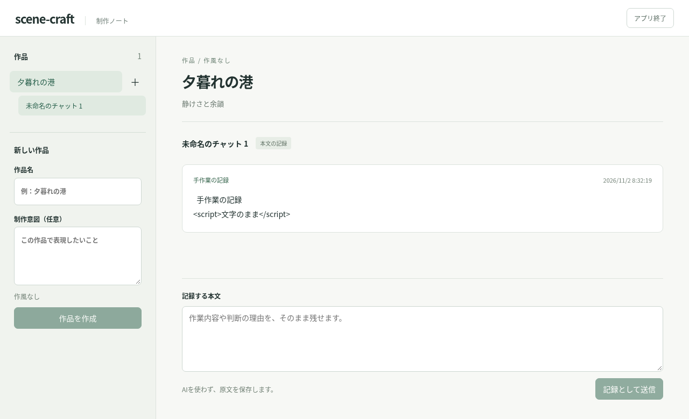

# Issue #58 の実装と確認

対象は作品・空の会話・LLMなしの本文記録。添付、制作ファイル、Codex接続、命名・要約、編集案、バックアップは後続Issueとし、この画面に利用可能な操作として出さない。作品は作風なし、会話名は未命名のまま保持する。

## 起動

WSLのLinuxファイルシステムへcloneし、Node.js 24.19.0以上の24系で実行する。依存はpackage-lock.jsonで固定し、SQLiteはNode同梱の`node:sqlite`を使用する（Node 24では実験的APIの警告が出る）。

```sh
npm ci
npm run build
npm start -- --data-dir "$HOME/.local/share/scene-craft" --port 4317
```

`http://localhost:4317`を開く。IPアドレスのURLはHost検査で拒否する。バックエンドは127.0.0.1だけで待ち受ける。通常は下記のWindowsショートカットを使い、端末の生存に依存させない。

Windows PowerShellで、リポジトリの`scripts/windows`をWindows側の任意フォルダーへコピーして実行する。Nodeの絶対パスはWSLで`command -v node`から取得する。設定には実際のディストリビューション名と絶対パスを指定する。

```powershell
.\Install-Shortcut.ps1 -Distribution Ubuntu -WslNode /absolute/path/to/node -WslRepository /home/user/scene-craft -DataDirectory /home/user/.local/share/scene-craft
```

デスクトップのショートカットは独立した非表示PowerShell管理プロセスを開始し、foregroundのWSLバックエンドを実行する`wsl.exe`を終了まで保持する。ブラウザはその準備完了後に開く。「アプリ終了」でバックエンドを閉じる。WSL強制終了・Windowsログアウト後の継続は保証しない。管理設定は`%LOCALAPPDATA%\scene-craft\launcher.json`、固定コードのみのログは`logs`配下（30日／合計1GiBで整理）。ログに原文・資格情報・設定内容を出さない。

起動時は別の`owner.sqlite`の排他トランザクションをプロセス全期間保持し、同じ保存先の二つ目の書き込み所有者を拒否する。OSがクラッシュ時にもロックを解放する。既存プロセスは所有者限定の`instance.json`にある起動時秘密とチャレンジのHMACを照合し、単なるポート開放やアプリ名では識別しない。二重起動時には実際の既存ポートを返す。別アプリの占有は`PORT_IN_USE`、所有者の応答が照合できない場合は`OWNER_NOT_READY`とする。自動で所有プロセスを殺したりロックを強奪しない。

## 公開操作と保存

| 操作 | HTTP |
| --- | --- |
| ローカルセッション取得 | GET /api/session |
| 作品一覧／作成 | GET /api/works・POST /api/works |
| 作品内の会話一覧／作成 | GET・POST /api/works/:id/conversations |
| 会話の本文一覧／記録 | GET・POST /api/conversations/:id/records |
| アプリ終了 | POST /api/shutdown |

変更要求は正確なHost・Origin、HttpOnly/SameSite=Strict CookieとCSRFヘッダー、JSONを要求する。クロスサイト要求・余分なフィールド・不正入力は拒否する。GETにもHost/Origin/Fetch Metadata検査、CORS不許可、CSP/frame拒否を適用する。これは同じOSユーザーを隔離する境界ではない。

作品作成は`requestKey,name,intent?`、会話作成は`requestKey`、記録は`requestKey,body`を受け付ける。受付キーは8〜128文字の英数字・`_`・`-`。作品名は非空白200文字、制作意図は任意20,000文字、本文は非空白200,000文字、要求全体1MiBまで。原文の空白・改行は正規化しない。空の制作意図を省略した場合はnull、未命名もnullとして保存する。

SQLiteの外部キー・確定順の整数・UUID・UTC時刻を保存し、時刻が同じでも順序を区別する。記録と受付結果を同じトランザクションに入れ、同じキー・同じ操作／対象／内容は同一結果、異内容は409にする。キーは操作をまたいで一意。失敗時は受付結果もロールバックし、再試行できる。クライアントは応答喪失後の同内容再送に同じキーを使い、保存成功を受信するまで入力を消さない。原文はReactのテキストとして描画する。

保存形式は`records.sqlite`のuser_version=1。未知の形式へ書き込まず起動失敗とする。自動移行・自動削除は導入しない。バックエンドの通常ログは無効で、DB例外に含まれ得る本文や個人パスを応答・標準エラーに出さない。

## 自動試験と実機の境界

```sh
npm ci
npx playwright install --with-deps chromium
npm run check
```

`npm run check`は型検査、公開HTTP操作→一時SQLite、起動CLIの実プロセス試験、製品ビルド、実HTTPに接続するブラウザ試験を実行する。SQLiteへのSQL照会を期待結果の観測に使わず、再起動後の公開読取でID・原文・順序・一度だけの登録を照合する。書き込み不能なDBは実ファイル権限で故障を起こす。ブラウザ試験の応答喪失では実バックエンドへ保存した後に応答だけを遮断する。作品作成失敗の画面試験のみHTTP 500を代替する。

`.github/workflows/ci.yml`の`verify`は全PRの作成・更新とmainへのpushで実行する。失敗時のスクリーンショット／traceと確認画像、対象commit・Node・Playwright・OSの版をArtifactへ保存する。Windows用スクリプトはPowerShellパーサーでも構文を検査するが、Windows実行時の合格にはしない。必須ステータスチェックはGitHubのmain保護設定で`verify`を要求し、管理者にも適用する。設定は実APIへの到達と管理権限が必要で、YAMLだけでは有効化されない。変更前のルールを維持し、既存必須チェックがあれば追加する。合格CIと故意の失敗CIがそれぞれマージ可否へ反映されるところまで確認する。

## Windows実機確認

```powershell
.\Test-Local.ps1 -Config "$env:LOCALAPPDATA\scene-craft\launcher.json"
```

WSL側を対象commitでビルドしてから実行する。未コミット変更があれば中断する。試験用の空の保存先を`/tmp/scene-craft-acceptance-<UUID>`へ分離し、設定・結果JSONを`%LOCALAPPDATA%\scene-craft\verification`へ保存する。ポートは本番と競合しないよう設定コピーで変更し、本番アプリは終了しておく。自動項目は実Windows→WSLの公開操作・原文再表示・同じキーの再送。実機検証用データ・設定は自動削除しない。

手動項目はショートカットでの起動、ブラウザと起動端末を閉じた後の継続、二重起動、別アプリのポート占有。結果JSONの`manual`には期待結果を含め、初期状態を`not_run`とする。試験用設定のショートカットで操作し、再起動前後のID照合、管理プロセス／wsl.exeの状態、画面・ログの証拠を残してactual/status/evidenceを埋める。ポート占有には試験用ポートを使い、所有していないアプリを終了しない。コマンド成功で手動項目をpassedにしない。

クラウドLinuxの成功はWindows固有の生存管理・localhost転送・PowerShell動作の合格を意味しない。Windows実機と必須チェックの設定確認が未実施なら、#58の受け入れ完了とはしない。

## 画面の確認

実バックエンドに接続したブラウザ試験の画面。本文中のHTML文字列を文字として表示し、保存後の再読取を確認する。画像は試験用の作品・原文のみを含む。



## レビューと残る受け入れ

`code-review`のStandards／Specを別のレビューで確認した。初期作品一覧の遅い応答が作成済み作品を画面から消す競合は、最初の一覧取得成功まで作成を待つ修正とブラウザ回帰試験で対応。Windowsログ初期化を例外処理内へ移し、整理競合を許容し、ログ書込不能でも起動失敗通知を出すよう修正した。データ取得Effectの重複は小規模な任意改善として保留した。

Linuxでの自動試験合格と、Windows/WSLの実機合格・main必須ステータスチェックの実確認を別々に記録する。後二者が残る間はDraft PRとし、Issue #58を閉じない。次回はWindows実機コマンドと手動項目の証跡、GitHub保護設定の既存ルールを保持した更新、失敗時にマージできないことの確認を行う。

## 2026-11-02 Windows起動失敗の修正

`Launcher.ps1` が `wsl.exe` の全引数を引用していたため、実Windowsでは `"--distribution"` がWSLのオプションとして認識されず、Linuxコマンドとして実行されていた。標準エラーは `/bin/bash: --distribution: コマンドが見つかりません`、終了コードは127で、ランチャーはこれを `START_FAILED` と表示した。設定とNode v24.19.0の実行は正常だった。

空白を含まない非空引数はそのまま渡し、空白を含む引数の引用と既存の不正入力拒否は維持する修正を適用した。修正後のcommit `0b8e301eab8e3ce755b42799f5a13db2069ee160` に対し、Windows PowerShell 5.1から上記の `Test-Local.ps1` を実行し、実ランチャー経由の起動、WindowsからのHTTP接続、作品・会話・原文記録の保存と再読取、同一キー再送の重複防止が成功した。環境はWindows 11（build 26300）、Ubuntu、Node v24.19.0。[結果JSON](assets/issue-58-windows-launcher.json)に対象commit・環境・期待/実結果を記録している。Standards／Specの別レビューはいずれも指摘なし。

この結果はデスクトップショートカットのクリック、ブラウザ／起動端末終了後の継続、二重起動、別アプリのポート占有の手動確認を代替しない。結果JSONの手動4項目は `not_run` のままとする。空白を含むパスでの追加起動確認と試験用アプリの終了をまとめたコマンドは自動承認レビューで拒否され、詳細な理由は返されなかったため、この追加確認は未実施。`Test-Local.ps1` が起動した試験用アプリは継続中なので、確認を終えたら画面の「アプリ終了」で終了する。

既存のデスクトップショートカットは `%LOCALAPPDATA%\scene-craft\Launcher.ps1` のインストール済みコピーを使う。修正版を使うには、更新後の `scripts/windows` をWindows側のインストール作業フォルダーへ再コピーし、同じ設定で `Install-Shortcut.ps1` を再実行する。リポジトリの更新だけではインストール済みコピーは変わらない。
## SQLiteの確認用コンソール

WSLのリポジトリルートで次を実行する。Python 3の標準ライブラリだけを使い、DBは読み取り専用で開く。存在しないDBを新規作成しない。

```sh
python3 scripts/db-console.py
```

通常の保存先は `~/.local/share/scene-craft/records.sqlite`。別の保存先を使う場合は、DBファイルのパスを引数に渡す。

```sh
python3 scripts/db-console.py /path/to/data/records.sqlite
```

コンソールでは `.tables` でテーブル一覧、`.schema` で定義、`.help` で操作説明を表示し、`.quit` またはCtrl+Dで終了する。SQLは末尾にセミコロンを付ける。結果は1行につき1件のJSONで表示するため、本文の改行は `\n` と表示される。SQLエラー後も入力を続けられるが、終了コードは1になる。

```sql
SELECT id, name, intent FROM works;
SELECT id, work_id FROM conversations;
SELECT conversation_id, body, created_at FROM records ORDER BY sequence;
```

Windows PowerShellから利用する場合は `wsl -d Ubuntu` でWSLへ入り、`cd ~/scene-craft` でリポジトリへ移動してから上記コマンドを実行する。

詳しい接続・SQL入力・終了・エラー時の手順は [SQLite接続手順](db-console.md) を参照。
